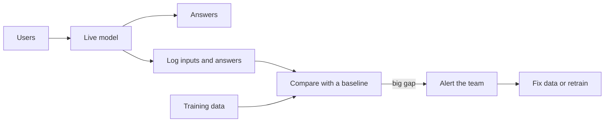

> [!crumbs] [[00 Start Here|🏠 Home]] › [[Part 2 AI System Design|Part 2]] › [[The 12 Ribs]] › AI Monitoring & Observability

> [!tldr] In one sentence
> AI monitoring means **watching a live model's inputs, answers and results** so you notice when it quietly gets worse, before your users do.

## 🧠 Think of it like…

> [!analogy] A weather forecaster's report card
> A forecaster learned from years of past weather. The climate shifts a little each year. Unless someone compares forecasts with what really happened, nobody notices them slipping.

The forecaster is your model, and the past weather is its **training data** (the examples it learned from). Monitoring is the report card.

## What it is

A model can keep running, fast and error-free, while its answers get steadily worse. Monitoring catches that **silent failure** by watching three things:

- **The inputs.** Do they still look like what the model learned from?
- **The outputs.** Has the mix of answers shifted, say from 5% "fraud" flags to 30%?
- **The outcomes.** When the truth arrives later, was the model right?

**Observability** means recording enough detail (requests, answers, costs, delays) to explain *why* something went wrong.

## Why it matters

The world moves, but a trained model stays frozen. Two kinds of change hurt it:

- **Data drift** is when the inputs change, like a shop suddenly getting customers from a new country.[^1]
- **Concept drift** is when the link between inputs and the right answer changes. Shopping patterns during COVID-19 are a famous example: old lessons simply stopped being true.[^2]

Broken data feeds hurt too, and the model never complains. Google engineers warned that such hidden problems pile up quietly in ML systems.[^3]

## How it works

1. **Log.** Save a sample of what goes into and comes out of the model.
2. **Pick a baseline.** This is "normal", usually the training data or last month's live traffic.[^4]
3. **Compare.** Measure how far today's data has moved from the baseline. Tools turn this into a single **drift score**.[^4]
4. **Alert.** If the score crosses a threshold you choose, a person gets notified.[^4]
5. **Act.** Fix a broken pipeline, or **retrain** the model on fresh data.[^2]

Chatbots often have no single right answer. So teams add **online evaluations**: another model, a person or a simple rule scores a sample of real conversations.[^5]

## A real-world example

At Uber, part of the fare data went missing for 10% of sessions in key US cities. A data scientist spotted it by hand after 45 days.[^6] Uber then built D3, which checks important data every day. It cut the average time to spot such problems more than 20 times, to about 2 days.[^6]

## Myths and pitfalls

- **❌ Myth:** If the servers are healthy, the model is healthy. **✅ Reality:** A model can be fast and error-free while giving worse answers every week.[^3]
- **❌ Myth:** Every drift alert means retrain now. **✅ Reality:** Many alerts come from broken data, not a changed world. Check the data first.[^1]
- **❌ Myth:** You'll know right away if the model is wrong. **✅ Reality:** The true answer can arrive weeks or months later, so teams watch inputs as an early warning.[^1]

## Check yourself

> [!question]- What is the difference between data drift and concept drift?
> Data drift means the inputs changed. Concept drift means the relationship between inputs and the right answer changed, so the model's lessons are out of date.

> [!question]- Why watch inputs if what you care about is accuracy?
> Because the true answers often arrive late. A shift in inputs is an early clue that accuracy may be dropping.

> [!question]- A drift alert fires overnight. What should you check before retraining?
> Whether the data itself is broken, such as a missing field. Retraining on broken data makes things worse.

## Key terms

- **Monitoring** — continuously checking a live model's inputs, outputs and results.
- **Observability** — recording enough detail to explain why the system behaved as it did.
- **Data drift** — the inputs a model sees in production change over time.
- **Concept drift** — the link between inputs and correct answers changes.
- **Baseline** — the "normal" data you compare against, often the training data.
- **Ground truth** — the real outcome, used to check whether a prediction was right.

## 🧱 Builds on

- [[Logging]] — every model request and answer is logged so it can be compared and replayed later.
- [[Metrics]] — drift scores, accuracy and cost become time series with alert thresholds.
- [[Distributed Tracing]] — one chatbot answer can involve many model and tool calls, and a trace links them.

> [!deepdive] Ready for the technical take?
> Skew vs. drift math, delayed labels, Google's monitoring tests, LLM tracing conventions and how Uber's D3 works.
> → [[AI Monitoring & Observability (Deep Dive)]]

## Related

- [[Evaluation & Metrics]] — the quality measures monitoring keeps checking after launch.
- [[MLOps & CI-CD]] — monitoring alerts are what trigger automatic retraining.
- [[Data Engineering & Pipelines]] — most "model" problems start as data problems upstream.
- [[Deployment & Serving]] — where the logs and live traffic come from.
- [[Guardrails & AI Safety]] — real-time checks that block bad answers before users see them.

> [!nav] Keep going
> ← [[AI Scalability & Distributed Systems]] · [[The 12 Ribs|☂️ The 12 Ribs]] · [[MLOps & CI-CD]] →
> 🔬 Technical take: [[AI Monitoring & Observability (Deep Dive)]] · 🗺️ [[Glossary]]

## 📚 Sources

[^1]: 📝 [What is data drift in ML, and how to detect and handle it](https://www.evidentlyai.com/ml-in-production/data-drift) — Evidently AI. Article. Checked 2026-11.
[^2]: 📝 [What is concept drift in ML, and how to detect and address it](https://www.evidentlyai.com/ml-in-production/concept-drift) — Evidently AI. Article. Checked 2026-11.
[^3]: 🔬 [Hidden Technical Debt in Machine Learning Systems](https://proceedings.neurips.cc/paper_files/paper/2015/file/86df7dcfd896fcaf2674f757a2463eba-Paper.pdf) — Sculley et al., NeurIPS 2015. Paper. Checked 2026-11.
[^4]: 📄 [Introduction to Vertex AI Model Monitoring](https://docs.cloud.google.com/vertex-ai/docs/model-monitoring/overview) — Google Cloud. Official docs. Checked 2026-11.
[^5]: 📄 [Evaluation core concepts](https://langfuse.com/docs/evaluation/core-concepts) — Langfuse documentation. Official docs. Checked 2026-11.
[^6]: 📝 [D3: An Automated System to Detect Data Drifts](https://www.uber.com/blog/d3-an-automated-system-to-detect-data-drifts) — Uber Engineering, 2023. Engineering blog. Checked 2026-11.
