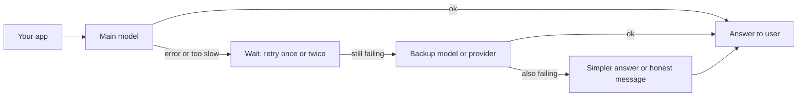

> [!crumbs] [[00 Start Here|🏠 Home]] › [[Part 2 AI System Design|Part 2]] › [[The 12 Ribs]] › AI Reliability & Fault Tolerance

> [!tldr] In one sentence
> AI reliability means keeping an AI feature useful when the model, its chips or the company you rent it from has a bad day, by **retrying carefully, switching to a backup and degrading gracefully** instead of simply breaking.

## 🧠 Think of it like…

> [!analogy] A restaurant with a broken pizza oven
> A good restaurant doesn't lock its doors when the pizza oven dies. It serves pasta from the stove, tells guests the honest wait, and calls a repair person while it keeps serving.

The oven is your main AI model. The stove is a **backup model**. The honest message is **graceful degradation**: a simpler service instead of none. The repair call is **incident response**, the organized way a team fixes an outage.

## What it is

An AI feature depends on a chain: your app, a model provider reached over the internet, and the GPUs (specialized chips) that run the model. Any link can fail:

- **Errors.** The provider is busy. Anthropic's API returns an "overloaded" error when traffic is high across all users.[^1]
- **Limits.** You send more requests than your plan allows, and the provider tells you to slow down.[^1]
- **Slowness.** A stuck request can tie up your app.
- **Quietly worse answers.** The model still replies, but worse. Nothing looks broken on a dashboard.

## Why it matters

- **Whole providers go down.** On December 11, 2024, every OpenAI service was degraded or down for over four hours.[^2] Products built only on OpenAI went down with it.
- **Careless fixes make it worse.** Retrying too hard piles load on a service that is already struggling.[^3]

## How it works

Teams stack a few defenses:

- **Retry politely.** Wait a little, then longer each time, plus a random delay so thousands of apps don't retry at the same instant. Keep retries few.[^3]
- **Fall back.** If the main model keeps failing, send the request to a backup model, provider or region. Tools such as LiteLLM let teams list backups in order.[^4]
- **Trip a circuit breaker.** After repeated failures, stop calling the sick service for a while and fail fast. That gives it room to recover.[^5]
- **Watch quality, not just uptime.** Run quality checks on live traffic so quietly worse answers get caught.[^6]
- **Practice incident response.** One person leads, others fix, and someone keeps everyone informed.[^7]

## A real-world example

OpenAI's December 2024 outage started with a new monitoring service. It overloaded the control system of OpenAI's computer clusters, which broke how its services found each other.[^2] The fix needed that same overloaded system, so recovery took hours.[^2]

The lesson: decide in advance what your product does when its provider is down.

## Myths and pitfalls

- **❌ Myth:** More retries mean more reliability. **✅ Reality:** If five layers of software each retry three times, a struggling database can see 243 times the traffic.[^3]
- **❌ Myth:** If the API answers, the AI is working. **✅ Reality:** In August 2025, infrastructure bugs quietly degraded some Claude answers; at the worst hour, 16% of one model's requests were hit.[^6]
- **❌ Myth:** A backup model is a drop-in replacement. **✅ Reality:** Backups can differ in limits and behavior, so test them with your real prompts.[^4]

## Check yourself

> [!question]- Why add a random delay to retries?
> Otherwise every client that failed together retries together, hitting the struggling service with a second wave.

> [!question]- What does a circuit breaker do?
> After enough failures it stops calling the failing service for a while, so your app fails fast and the service can recover.

> [!question]- Why isn't "the API is up" enough to call an AI feature healthy?
> The model can keep replying while its answers get worse. You need ongoing quality checks on real traffic.

## Key terms

- **Fallback** — a backup model, provider or region used when the main one fails.
- **Exponential backoff** — waiting longer after each failed attempt.
- **Jitter** — a small random delay that spreads retries out.
- **Circuit breaker** — a switch that stops calls to a failing service for a while.
- **Graceful degradation** — offering a simpler service instead of failing completely.
- **Incident commander** — the one person who leads the response to an outage.

## 🧱 Builds on

- [[Fault Tolerance]] — retries, timeouts and circuit breakers, now aimed at models.
- [[Rate Limiting]] — providers rate-limit you, and your own limits protect a shared model.
- [[Message Queues]] — queued work is delayed by a model outage instead of lost.
- [[Replication]] — the same model in several regions or providers is replication for AI.

> [!deepdive] Ready for the technical take?
> Which errors to retry, fallback chains with cooldowns, retry budgets, silent quality regressions, training failures and incident playbooks.
> → [[AI Reliability & Fault Tolerance (Deep Dive)]]

## Related

- [[AI Monitoring & Observability]] — you can only fall back from failures you can see.
- [[Deployment & Serving]] — where replicas, regions and rollouts are set up.
- [[Evaluation & Metrics]] — the quality checks that catch quietly worse answers.
- [[Cost Optimization]] — backups and spare capacity cost money.

> [!nav] Keep going
> ← [[Cost Optimization]] · [[The 12 Ribs|☂️ The 12 Ribs]] · [[Ethics & Governance]] →
> 🔬 Technical take: [[AI Reliability & Fault Tolerance (Deep Dive)]] · 🗺️ [[Glossary]]

## 📚 Sources

[^1]: 📄 [Claude API errors](https://platform.claude.com/docs/en/api/errors) — Anthropic, Claude Platform docs. Official docs. Checked 2026-11.
[^2]: 📄 [API, ChatGPT & Sora Facing Issues (write-up)](https://status.openai.com/incidents/ctrsv3lwd797/write-up) — OpenAI Status. Official postmortem. Checked 2026-11.
[^3]: 📝 [Timeouts, retries, and backoff with jitter](https://builder.aws.com/content/3EumjoZascWd1oZiEgL8ORlv3qE/timeouts-retries-and-backoff-with-jitter) — Amazon Builders' Library, AWS. Engineering blog. Checked 2026-11.
[^4]: 📄 [Fallbacks (Provider Failover)](https://docs.litellm.ai/docs/proxy/reliability) — LiteLLM documentation. Official docs. Checked 2026-11.
[^5]: 📝 [CircuitBreaker](https://martinfowler.com/bliki/CircuitBreaker.html) — Martin Fowler. Article. Checked 2026-11.
[^6]: 📝 [A postmortem of three recent issues](https://www.anthropic.com/engineering/a-postmortem-of-three-recent-issues) — Anthropic Engineering. Engineering blog. Checked 2026-11.
[^7]: 📘 [Managing Incidents](https://sre.google/sre-book/managing-incidents/) — Site Reliability Engineering, Google (O'Reilly). Book. Checked 2026-11.
