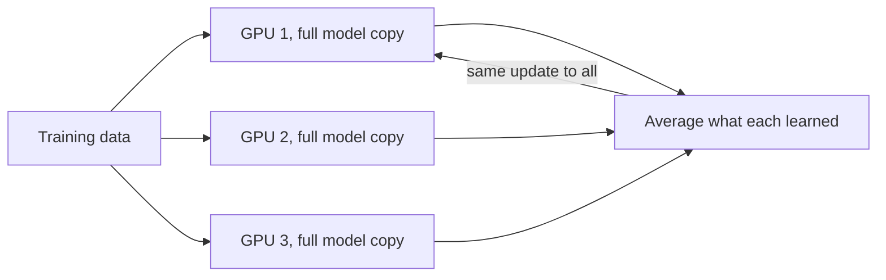

> [!crumbs] [[00 Start Here|🏠 Home]] › [[Part 2 AI System Design|Part 2]] › [[The 12 Ribs]] › AI Scalability & Distributed Systems

> [!tldr] In one sentence
> Modern AI is too big and too busy for one computer, so the work is **split across many chips that act as one**: for training the model and for answering users.

## 🧠 Think of it like…

> [!analogy] A bakery with a huge order
> For 10,000 cupcakes, you hire more bakers; each uses the same recipe on their own share. For one wedding cake too big for any oven, you bake the tiers in different ovens and stack them.

More bakers on one recipe is **data parallelism**. One giant cake across ovens is **model parallelism**. Calling in staff when orders surge is **autoscaling**.

## What it is

AI models run on **GPUs**, chips built to do huge amounts of math at once. Big models need far more math and memory than one GPU has, so teams link thousands of them into a **GPU cluster** with very fast networks.[^1]

There are two basic ways to share the work:[^2]

- **Data parallelism.** Every GPU holds a full copy of the model and learns from a different slice of the data. They combine what they learned so copies stay identical.
- **Model parallelism.** The model itself is cut into pieces, and each GPU holds one piece. This is the answer when the model is too big for one chip's memory.

## Why it matters

- **Time.** Splitting the data across many GPUs cuts training time sharply.[^2]
- **Size.** Plain data parallelism only works if the whole model fits on one GPU; bigger models must be split.[^3]
- **Demand.** Traffic to an AI app rises and falls. Serving must grow and shrink with it.[^4]

## How it works

In data parallelism, each GPU studies its own batch of examples and works out how the model should change. The GPUs then average those changes and apply the same update, so every copy stays in step.[^2]

When the model is too big, the cut can go two ways.[^2] **Pipeline parallelism** gives each GPU a group of layers, like stations on an assembly line. **Tensor parallelism** slices the math inside each layer so several GPUs share it. The largest models combine all of these at once.[^2]

For serving, the scaling is simpler: run more copies of the model and spread requests among them. An **autoscaler** watches a measure such as CPU use or request load and adds or removes copies to match.[^4]

## A real-world example

Meta trained its Llama 3 model, with **405 billion parameters** (the numbers a model learns), on up to **16,000 Nvidia H100 GPUs** at once, combining four kinds of parallelism.[^5] Its clusters each hold 24,576 GPUs joined by very fast network links.[^1]

At that scale, things break constantly. In one 54-day stretch, the training job was interrupted 466 times, mostly by hardware faults, yet useful training time stayed above 90%.[^5]

## Myths and pitfalls

- **❌ Myth:** Twice the GPUs means twice the speed. **✅ Reality:** GPUs spend time talking to each other, and that overhead grows with scale.[^3]
- **❌ Myth:** More GPUs just work out of the box. **✅ Reality:** Meta's big clusters were first slower and less consistent than small ones until the network and software were tuned.[^1]
- **❌ Myth:** Hardware failures are rare. **✅ Reality:** With thousands of chips, something fails several times a day, so jobs must save progress often and restart quickly.[^5]
- **❌ Myth:** Scaling is only about training. **✅ Reality:** Serving users at scale needs copies and autoscaling too.[^4]

## Check yourself

> [!question]- A model fits easily on one GPU, but training is too slow. Which parallelism first?
> Data parallelism: each GPU gets a full copy and its own slice of data.

> [!question]- When must you use model parallelism?
> When the model is too big for one GPU's memory.

> [!question]- Why do huge training jobs save their progress so often?
> Across thousands of chips, failures happen several times a day. Frequent saves mean a crash loses little work.

## Key terms

- **GPU** — a chip that does huge amounts of math at once.
- **GPU cluster** — many GPUs linked by fast networks.
- **Data parallelism** — each GPU holds the whole model and trains on different data.
- **Model parallelism** — the model is split, and each GPU holds one piece.
- **Autoscaling** — automatically adding or removing machines as demand changes.
- **Checkpoint** — a saved snapshot of training progress to restart from.

## 🧱 Builds on

- [[Sharding]] — model parallelism and sharded training split a model's state across GPUs, like rows across database shards.
- [[Replication]] — data parallelism keeps identical model copies in sync, and serving runs replicas.
- [[Load Balancing]] — spreads user requests across model replicas.
- [[Concurrency]] — thousands of GPUs work at once and must stay coordinated.

> [!deepdive] Ready for the technical take?
> All-reduce, FSDP and ZeRO, tensor and pipeline parallelism, Llama 3's 4D setup and autoscaling math.
> → [[AI Scalability & Distributed Systems (Deep Dive)]]

## Related

- [[Cloud & Infrastructure]] — where the GPUs come from.
- [[Deployment & Serving]] — the serving side of scaling.
- [[AI Reliability & Fault Tolerance]] — surviving constant hardware failures.

> [!nav] Keep going
> ← [[Deployment & Serving]] · [[The 12 Ribs|☂️ The 12 Ribs]] · [[AI Monitoring & Observability]] →
> 🔬 Technical take: [[AI Scalability & Distributed Systems (Deep Dive)]] · 🗺️ [[Glossary]]

## 📚 Sources

[^1]: 📝 [Building Meta's GenAI Infrastructure](https://engineering.fb.com/2024/03/12/data-center-engineering/building-metas-genai-infrastructure/) — Lee, Gangidi and Oldham, Engineering at Meta, 2024. Engineering blog. Checked 2026-11.
[^2]: 📄 [Parallelism methods](https://huggingface.co/docs/transformers/perf_train_gpu_many) — Hugging Face Transformers documentation. Official docs. Checked 2026-11.
[^3]: 📝 [Introducing PyTorch Fully Sharded Data Parallel (FSDP) API](https://pytorch.org/blog/introducing-pytorch-fully-sharded-data-parallel-api/) — PyTorch Blog. Engineering blog. Checked 2026-11.
[^4]: 📄 [Horizontal Pod Autoscaling](https://kubernetes.io/docs/concepts/workloads/autoscaling/horizontal-pod-autoscale/) — Kubernetes documentation. Official docs. Checked 2026-11.
[^5]: 🔬 [The Llama 3 Herd of Models](https://arxiv.org/html/2407.21783v3) — Grattafiori et al., arXiv 2407.21783, 2024, section 3.3. Paper. Checked 2026-11.
