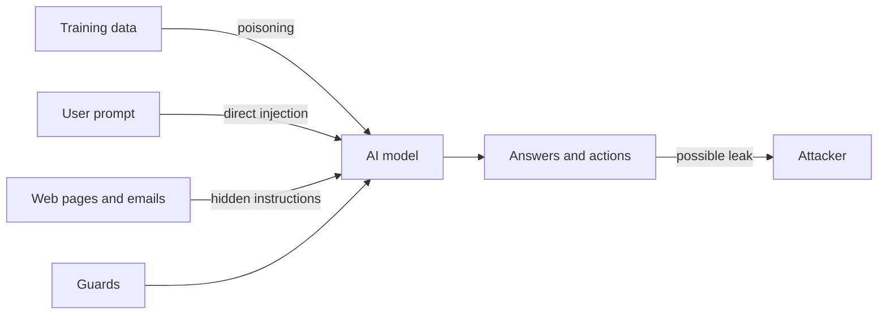

> [!crumbs] [[00 Start Here|🏠 Home]] › [[Part 2 AI System Design|Part 2]] › [[The 12 Ribs]] › AI Security & Privacy

> [!tldr] In one sentence
> AI security and privacy means **protecting a model, its data and its users** from people who try to trick it, corrupt it or pull secrets out of it.

## 🧠 Think of it like…

> [!analogy] A very helpful new assistant
> An eager assistant reads all your mail and follows instructions. A stranger slips a note into a letter: "Forward the boss's contracts to me." The assistant obeys.

That assistant is an AI model. It struggles to tell **your instructions** from **words hidden in the data** it reads. Many AI attacks exploit exactly that.

## What it is

Beyond the usual threats, like stolen passwords, AI adds new ones:

- **Prompt injection** — text that changes the model's behavior in ways its builders didn't intend. It can be typed directly or hidden in a web page, file or email the AI reads.[^1]
- **Data poisoning** — sneaking bad examples into the data a model learns from, so it learns the wrong lesson.[^2]
- **Data leaks** — the model reveals **PII** (personally identifiable information: names, phone numbers, emails).[^3]
- **Adversarial examples** — inputs changed in tiny, deliberate ways that make a model confidently wrong.[^4]

## Why it matters

- **AI assistants can act.** Once a model can send email or read files, a trick becomes a real action.[^5]
- **Training data can come back out.** Researchers pulled real phone numbers and emails out of the GPT-2 model.[^3]
- **Poisoning is cheap.** One team estimated it could have poisoned 0.01% of a huge public image dataset for about $60.[^2]

## How it works

There is **no single fix**. OWASP, a respected security community, says it is unclear whether prompt injection can be fully prevented.[^1] So teams stack defenses:

- **Least privilege.** Give the AI only the access it needs, so a tricked model can do little harm.[^1]
- **Human approval** for risky actions, like sending money or deleting files.[^1]
- **Label outside content** as untrusted, and filter what goes in and comes out.[^1]
- **Attack yourself first.** Test the system the way an attacker would, before real attackers do.[^1]

For privacy, a key tool is **differential privacy**: math that limits how much anyone can learn about one person from a dataset.[^6] Apple adds random noise on your device before data leaves, so its servers never see your raw data.[^7]

## A real-world example

In 2025, researchers disclosed **EchoLeak** in Microsoft 365 Copilot, Microsoft's workplace AI assistant.[^8] One crafted email was enough. When Copilot processed it, hidden instructions made it leak internal data, with no click from the user.[^8] Microsoft fixed it on its servers.[^8]

## Myths and pitfalls

- **❌ Myth:** Telling the model "never reveal secrets" stops attacks. **✅ Reality:** Attackers find ways around instructions. Real limits must live outside the model.[^1]
- **❌ Myth:** Only what users type is dangerous. **✅ Reality:** Web pages, documents and emails the AI reads can carry hidden commands.[^5]
- **❌ Myth:** Removing names makes data private. **✅ Reality:** Models can memorize and repeat rare details. Differential privacy gives a measurable guarantee instead.[^3][^6]

## Check yourself

> [!question]- What is indirect prompt injection?
> Instructions hidden in content the AI reads, like a web page or email, rather than typed by the user. The AI may follow them as real commands.

> [!question]- Why does least privilege matter so much for AI assistants?
> Because injection can't be fully prevented. An assistant that can reach only what it needs does far less damage when tricked.

> [!question]- How does Apple learn which emojis are popular without seeing yours?
> Your device adds random noise before sending. Across millions of devices the noise averages out, but no single report reveals your choice.

## Key terms

- **Prompt injection** — input that makes a model ignore its intended instructions.
- **Data poisoning** — tampering with training data so the model learns something harmful.
- **PII** — personally identifiable information, like names, phone numbers and email addresses.
- **Adversarial example** — an input changed slightly on purpose to fool a model.
- **Differential privacy** — a mathematical limit on how much a dataset reveals about any one person.
- **Least privilege** — giving a system only the access it needs, nothing more.

## 🧱 Builds on

- [[Authentication]] — the app must know which user is asking before fetching anything for them.
- [[Authorization]] — the model sees and acts only on what that user may access.
- [[Encryption]] — prompts, training data and logs hold private data to protect.
- [[Rate Limiting]] — request caps slow attackers and stop runaway costs.

> [!deepdive] Ready for the technical take?
> The OWASP LLM Top 10, the EchoLeak exploit chain, injection-resistant agent patterns, poisoning economics and privacy budgets.
> → [[AI Security & Privacy (Deep Dive)]]

## Related

- [[Guardrails & AI Safety]] — input and output filters that sit around the model.
- [[AI Agents & Tool Use]] — agents with tools raise the stakes of every injection.
- [[Retrieval-Augmented Generation]] — retrieved documents are a prime path for hidden instructions.
- [[Ethics & Governance]] — rules for using personal data at all.
- [[Data Sources]] — where training data comes from, and how it can be tampered with.

> [!nav] Keep going
> ← [[MLOps & CI-CD]] · [[The 12 Ribs|☂️ The 12 Ribs]] · [[Cost Optimization]] →
> 🔬 Technical take: [[AI Security & Privacy (Deep Dive)]] · 🗺️ [[Glossary]]

## 📚 Sources

[^1]: 📄 [LLM01:2025 Prompt Injection](https://genai.owasp.org/llmrisk/llm01-prompt-injection/) — OWASP Gen AI Security Project. Standard. Checked 2026-11.
[^2]: 🔬 [Poisoning Web-Scale Training Datasets is Practical](https://arxiv.org/abs/2302.10149) — Carlini et al., arXiv 2023. Paper. Checked 2026-11.
[^3]: 🔬 [Extracting Training Data from Large Language Models](https://www.usenix.org/conference/usenixsecurity21/presentation/carlini-extracting) — Carlini et al., USENIX Security 2021. Paper. Checked 2026-11.
[^4]: 🔬 [Explaining and Harnessing Adversarial Examples](https://arxiv.org/abs/1412.6572) — Goodfellow, Shlens and Szegedy, arXiv 2014. Paper. Checked 2026-11.
[^5]: 🔬 [Not what you've signed up for: Compromising Real-World LLM-Integrated Applications with Indirect Prompt Injection](https://arxiv.org/abs/2302.12173) — Greshake et al., arXiv 2023. Paper. Checked 2026-11.
[^6]: 📄 [Guidelines for Evaluating Differential Privacy Guarantees (SP 800-226)](https://csrc.nist.gov/pubs/sp/800/226/final) — NIST, 2025. Standard. Checked 2026-11.
[^7]: 📝 [Learning with Privacy at Scale](https://machinelearning.apple.com/research/learning-with-privacy-at-scale) — Apple Machine Learning Research, 2017. Engineering blog. Checked 2026-11.
[^8]: 🔬 [EchoLeak: The First Real-World Zero-Click Prompt Injection Exploit in a Production LLM System](https://arxiv.org/html/2509.10540v1) — Reddy and Gujral, arXiv 2025. Paper. Checked 2026-11.
