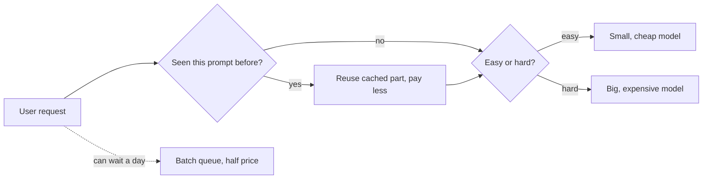

> [!crumbs] [[00 Start Here|🏠 Home]] › [[Part 2 AI System Design|Part 2]] › [[The 12 Ribs]] › Cost Optimization

> [!tldr] In one sentence
> Cost optimization means getting **the same useful answers from AI for less money**, by using the right-sized model, never paying twice for the same work, and renting computers only when you need them.

## 🧠 Think of it like…

> [!analogy] Running a delivery business
> You don't send a moving truck to deliver one envelope. You use a bike for small jobs, save parcels for one evening run, and rent extra vans only on busy days.

A **big model** is the truck: powerful and pricey. A small model is the bike. The evening run is batching; the vans are computers rented by the hour.

## What it is

If you use a model from a provider, you pay per **token**, a chunk of text about the size of a short word. The words the model writes usually cost about five times more than the words you send it.[^1]

If you run your own model, you pay for **GPUs**, the special chips that do the heavy math, for every hour they are switched on, busy or not.[^2]

## Why it matters

- **AI bills grow with success.** Every new user adds tokens.
- **The price gap is huge.** In one provider's small, medium and large lineup, the large model costs 40 times more per input token than the small one.[^1]
- **Savings buy features.** The goal is not to spend nothing, but to get the most value from each dollar.[^3]

## How it works

Teams combine a handful of moves:

- **Pick the smallest model that is good enough.** AWS advises starting small and moving up only until quality is acceptable. A **router** can send each request to a small or big model depending on how hard it looks.[^2]
- **Don't pay twice for the same words.** **Prompt caching** lets a provider remember a long instruction or document you send again and again.[^4]
- **Wait when you can.** Jobs that don't need an instant reply can go to a **batch** service. OpenAI's costs 50% less and finishes within 24 hours.[^5]
- **Rent spare computers.** Clouds sell unused machines, called **spot instances**, at up to 90% off, but can take them back.[^6]
- **Shrink the model.** **Distillation** trains a small "student" model to copy a big "teacher," keeping much of the skill in a model that is far easier to run.[^7]

**FinOps**, short for financial operations, is the people side: engineering, finance and business teams sharing cost data and deciding together where money is best spent.[^3]

## A real-world example

Notion added prompt caching to Notion AI to make it faster and cheaper.[^4] In Anthropic's own test, chatting with a 100,000-token book cost 90% less with caching, and answers started in 2.4 seconds instead of 11.5.[^4] The book was processed once, not on every question.

## Myths and pitfalls

- **❌ Myth:** The biggest model is always the safe choice. **✅ Reality:** For simple tasks, a small model is often good enough at a fraction of the price.[^2]
- **❌ Myth:** Cutting cost means cutting quality. **✅ Reality:** The aim is the same quality for less; FinOps is about value, not just saving.[^3]
- **❌ Myth:** Spot machines are free money. **✅ Reality:** They can vanish with two minutes' warning, so the work must survive interruption.[^8]

## Check yourself

> [!question]- Why send easy questions to a small model?
> It costs far less per token. If it answers well enough, you save most of the money and keep the big model for hard cases.

> [!question]- What kind of work suits a batch service?
> Work that can wait hours, like sorting a pile of documents overnight. You trade speed for price.

> [!question]- What does prompt caching save you?
> Paying full price to resend the same long instructions or documents on every request.

## Key terms

- **Token** — a small chunk of text that AI providers count and charge for.
- **GPU** — a chip built for the math AI models run on, usually rented by the hour.
- **Model routing** — sending each request to a cheaper or stronger model based on difficulty.
- **Prompt caching** — reusing a repeated part of a prompt at a lower price.
- **Spot instance** — a cheap spare cloud computer that can be taken back at short notice.
- **Distillation** — training a small model to imitate a bigger one.

## 🧱 Builds on

- [[Caching]] — prompt caching applies "keep a copy close" to repeated prompt text.
- [[Estimation]] — quick math on tokens and requests per day predicts the bill before launch.
- [[Serverless]] — pay-per-use hosting that shrinks to nothing when idle suits spiky AI traffic.

> [!deepdive] Ready for the technical take?
> Cost-per-request math, prompt-cache break-even, routing and distillation results, quantization and spot checkpointing.
> → [[Cost Optimization (Deep Dive)]]

## Related

- [[LLM Inference & Optimization]] — the serving tricks that make each token cheaper.
- [[Model Selection & Training]] — choosing the right-sized model in the first place.
- [[Cloud & Infrastructure]] — where GPU and pricing choices get made.
- [[AI Monitoring & Observability]] — tracking spend per feature so surprises show early.

> [!nav] Keep going
> ← [[AI Security & Privacy]] · [[The 12 Ribs|☂️ The 12 Ribs]] · [[AI Reliability & Fault Tolerance]] →
> 🔬 Technical take: [[Cost Optimization (Deep Dive)]] · 🗺️ [[Glossary]]

## 📚 Sources

[^1]: 📄 [Pricing](https://platform.claude.com/docs/en/about-claude/pricing) — Anthropic, Claude Platform docs. Official docs. Checked 2026-11.
[^2]: 📄 [GENCOST01-BP01 Right-size model selection to optimize inference costs](https://docs.aws.amazon.com/wellarchitected/latest/generative-ai-lens/gencost01-bp01.html) — AWS Well-Architected Generative AI Lens. Official docs. Checked 2026-11.
[^3]: 📄 [What is FinOps?](https://learn.microsoft.com/en-us/cloud-computing/finops/overview) — Microsoft Learn. Official docs. Checked 2026-11.
[^4]: 📝 [Prompt caching with Claude](https://claude.com/blog/prompt-caching) — Anthropic. Engineering blog. Checked 2026-11.
[^5]: 📄 [Batch API](https://developers.openai.com/api/docs/guides/batch) — OpenAI API docs. Official docs. Checked 2026-11.
[^6]: 📄 [Amazon EC2 Spot Instances](https://aws.amazon.com/ec2/spot/) — Amazon Web Services. Official docs. Checked 2026-11.
[^7]: 🔬 [Distilling the Knowledge in a Neural Network](https://arxiv.org/abs/1503.02531) — Hinton, Vinyals and Dean, 2015. Paper. Checked 2026-11.
[^8]: 📄 [Spot Instance interruption notices](https://docs.aws.amazon.com/AWSEC2/latest/UserGuide/spot-instance-termination-notices.html) — Amazon EC2 User Guide. Official docs. Checked 2026-11.
