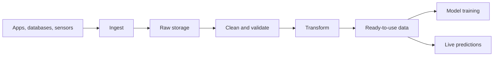

> [!crumbs] [[00 Start Here|🏠 Home]] › [[Part 2 AI System Design|Part 2]] › [[The 12 Ribs]] › Data Engineering & Pipelines

> [!tldr] In one sentence
> Data engineering builds the **pipelines** that collect raw data, clean it and deliver it on time, so AI models learn from and act on data you can trust.

## 🧠 Think of it like…

> [!analogy] A city's water system
> Water starts in rivers and wells. Pipes carry it to a treatment plant, where it is filtered and tested. Only then does it reach your tap.

Data is the water, and apps and sensors are the rivers. A **data pipeline** is the pipes plus the treatment plant: it moves, cleans and checks data. The AI model is the tap.

## What it is

Data engineering is the work of moving data from where it is created to where it is used. A pipeline is a chain of automatic steps that does this again and again.

The classic recipe is **ETL**: extract (copy data out of a source), transform (clean and reshape it), load (store it in its new home). A newer variant, **ELT**, loads the raw data first and transforms it later, inside a large cloud data store.[^1] ETL dates from the 1970s; ELT took off once cloud storage made keeping raw data at scale practical.[^1]

## Why it matters

- **Models are only as good as their data.** In real AI systems, Google engineers found, the code that learns is a tiny box. Most of the system collects, checks and moves data.[^2]
- **Bad data fails silently.** At Google Play, one data table went stale for six months. Refreshing it alone raised the install rate by 2%.[^3] Nothing crashed; the model just quietly got worse.
- **Freshness.** A fraud model needs a payment within seconds, not the next morning.

## How it works

A pipeline usually has four jobs:

- **Ingest.** Collect data from apps, databases and devices. It often passes through a [[Message Queues|message queue]], a waiting line that holds events until the next step is ready.[^4]
- **Store.** Keep an untouched raw copy somewhere cheap and safe, such as [[Object Storage|object storage]], so you can always reprocess it.
- **Clean and validate.** Remove duplicates, fix formats and check values look normal. Google's checker watches several petabytes of production data a day.[^5]
- **Serve.** Deliver tidy tables to model training and to live predictions.

Pipelines run at two speeds. **Batch processing** handles a big pile of data at once, say every night. **Stream processing** handles each event the moment it arrives, like a conveyor belt.[^6] Many teams run both.

## A real-world example

LinkedIn moves its data with Apache Kafka, a tool that streams events between systems. In 2015 it reported **more than 800 billion messages a day**, peaking above 13 million per second.[^7] Records of user actions flow into both real-time stream jobs and batch jobs on Hadoop, a system for crunching huge files. Those jobs feed search, usage tracking and growth reports.[^7]

## Myths and pitfalls

- **❌ Myth:** Data engineering is just copying files. **✅ Reality:** The hard part is keeping data correct, on time and consistent as sources change.[^2]
- **❌ Myth:** A better model fixes bad data. **✅ Reality:** Google's data-validation team found that bad input data can cancel out the gains of better models.[^5]
- **❌ Myth:** Streaming replaces batch. **✅ Reality:** They suit different jobs, and modern tools let one program run either way.[^6]

## Check yourself

> [!question]- What is the difference between ETL and ELT?
> ETL cleans data before storing it. ELT stores the raw data first and transforms it later, inside the destination.

> [!question]- When would you pick stream processing over batch?
> When the answer is only useful if fresh, like spotting fraud during a payment. A nightly sales report is fine as batch.

> [!question]- Why keep the raw data after you have cleaned it?
> If a cleaning step had a bug, you rerun the pipeline from the original.

## Key terms

- **Data pipeline** — an automatic chain of steps that moves and prepares data.
- **ETL / ELT** — extract, transform, load; or load first and transform later.
- **Ingestion** — collecting data from its sources.
- **Batch processing** — handling data in large scheduled chunks.
- **Stream processing** — handling each event as soon as it arrives.
- **Data validation** — automatic checks that data looks right.

## 🧱 Builds on

- [[Message Queues]] — events wait in a queue, so data creators and pipelines don't have to keep pace.
- [[Object Storage]] — the cheap, durable home for raw files.
- [[SQL Databases]] — a common source to extract from, and a home for clean tables.
- [[NoSQL Databases]] — fast stores holding ready-made data for live predictions.

> [!deepdive] Ready for the technical take?
> Kafka and replay, event time, ETL vs. ELT trade-offs, idempotent reruns and data validation gates.
> → [[Data Engineering & Pipelines (Deep Dive)]]

## Related

- [[Data Sources]] — where the raw data comes from in the first place.
- [[Feature Engineering]] — turns clean data into model inputs.
- [[Model Selection & Training]] — the biggest consumer of training data.
- [[MLOps & CI-CD]] — automates pipelines and models together.
- [[AI Monitoring & Observability]] — catches drifting data in production.

> [!nav] Keep going
> ← [[Cloud & Infrastructure]] · [[The 12 Ribs|☂️ The 12 Ribs]] · [[Model Selection & Training]] →
> 🔬 Technical take: [[Data Engineering & Pipelines (Deep Dive)]] · 🗺️ [[Glossary]]

## 📚 Sources

[^1]: 📄 [What's the Difference Between ETL and ELT?](https://aws.amazon.com/compare/the-difference-between-etl-and-elt/) — Amazon Web Services. Official docs. Checked 2026-11.
[^2]: 🔬 [Hidden Technical Debt in Machine Learning Systems](https://proceedings.neurips.cc/paper/2015/file/86df7dcfd896fcaf2674f757a2463eba-Paper.pdf) — Sculley et al., Google, NeurIPS 2015. Paper. Checked 2026-11.
[^3]: 📄 [Rules of Machine Learning](https://developers.google.com/machine-learning/guides/rules-of-ml) — Martin Zinkevich, Google for Developers, Rule #10. Official docs. Checked 2026-11.
[^4]: 📄 [Introduction](https://kafka.apache.org/intro) — Apache Kafka documentation. Official docs. Checked 2026-11.
[^5]: 🔬 [Data Validation for Machine Learning](https://research.google/pubs/data-validation-for-machine-learning/) — Breck et al., Google Research, SysML 2019. Paper. Checked 2026-11.
[^6]: 📄 [Basics of the Beam model](https://beam.apache.org/documentation/basics/) — Apache Beam documentation. Official docs. Checked 2026-11.
[^7]: 📝 [Running Kafka At Scale](https://engineering.linkedin.com/kafka/running-kafka-scale) — LinkedIn Engineering, 2015. Engineering blog. Checked 2026-11.
