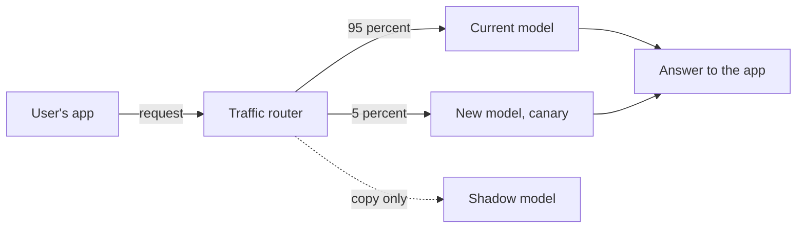

> [!crumbs] [[00 Start Here|🏠 Home]] › [[Part 2 AI System Design|Part 2]] › [[The 12 Ribs]] › Deployment & Serving

> [!tldr] In one sentence
> Deployment puts a trained model **where apps can ask it questions**, and serving is answering those questions quickly, reliably and safely all day.

## 🧠 Think of it like…

> [!analogy] A restaurant kitchen
> Writing a great recipe is one job. Cooking it for hundreds of diners a night is another. A new dish goes to a few tables before it joins the menu.

Training is writing the recipe. **Serving** is the kitchen taking orders from apps. Trying the dish on a few tables is a **canary release**.

## What it is

A trained model is just a file. To be useful it must run on servers and answer requests. That answering step is **inference**: the model takes an input, like a question, and returns a prediction.

The usual way to deploy is to wrap the model in a **prediction service**: a small program with a web address that other apps call, often a REST API (a standard way for programs to talk over the web).[^1] Google notes that model code is only a small part of a real ML system; serving and monitoring are much bigger.[^1]

## Why it matters

- **A model nobody can call has no value.** Users benefit only once it answers inside a product.
- **Speed is part of quality.** A fraud check must answer before the payment goes through.
- **New models can break things.** A model that tested well can still misbehave on live traffic, so releases need a safety net.[^2]

## How it works

There are two main ways to run a model:[^3]

- **Online (real-time) inference.** An always-on service answers each request in moments. Good for chat and fraud checks.
- **Batch inference.** The model processes a big pile of data at once, with no live service, like scoring every customer overnight.

**Serverless inference** starts machines only when requests arrive and scales to zero when idle, so you pay nothing between bursts.[^4] The catch is a **cold start**, a delay while machines spin up.[^4]

New versions roll out carefully:

- **Canary release.** Send a small share of users to the new model. If it behaves, raise the share; if not, send everyone back to the old one.[^2]
- **Shadow deployment.** Send a copy of real requests to the new model but discard its answers. Users only see the old model, so you compare speed and errors with zero risk.[^5]

## A real-world example

Uber built a platform called **Michelangelo** to deploy and serve models across the company. Its online prediction service runs on hundreds of machines behind a traffic router.[^6] In 2017 Uber reported that 95% of requests typically got an answer in under 10 milliseconds, and the busiest handled **over 250,000 predictions per second**.[^6] UberEATS used it to predict delivery times.[^6]

## Myths and pitfalls

- **❌ Myth:** Once training ends, the job is done. **✅ Reality:** Serving, rollout and monitoring are most of the work in a real system.[^1]
- **❌ Myth:** Every model needs a live service. **✅ Reality:** If answers can wait, batch inference is simpler and cheaper.[^3]
- **❌ Myth:** Serverless is always cheapest. **✅ Reality:** It suits spiky traffic that can tolerate cold starts.[^4]
- **❌ Myth:** A canary is an A/B test. **✅ Reality:** A canary hunts breakage in minutes or hours; an A/B test checks a hypothesis over days.[^2]

## Check yourself

> [!question]- A bank scores every customer's credit risk once a night. Online or batch?
> Batch. Nobody waits on the answer, so one big run is simpler and cheaper.

> [!question]- What is the difference between a canary and a shadow deployment?
> A canary shows some real users the new model's answers. A shadow gets copied requests, and nobody sees its answers.

> [!question]- Why might a serverless model feel slow to the first user of the morning?
> It scaled to zero overnight, so the first request waits for a cold start.

## Key terms

- **Inference** — running a trained model on new input to get a prediction.
- **Online inference** — answering each request right away.
- **Batch inference** — processing a large pile of inputs together.
- **Canary release** — giving a new version to a small share of users first.
- **Shadow deployment** — testing a new model on copied traffic, answers hidden.
- **Cold start** — the delay while idle machines start up.

## 🧱 Builds on

- [[API Design]] — the prediction service is an API, with requests, responses and versions.
- [[Load Balancing]] — a router spreads requests across model servers and splits canary traffic.
- [[Microservices]] — each model usually runs as its own small service other apps call.
- [[Serverless]] — serverless inference applies the scale-to-zero idea to models.

> [!deepdive] Ready for the technical take?
> Dynamic batching, LLM serving with PagedAttention, canary and shadow tooling, and real limits and latencies.
> → [[Deployment & Serving (Deep Dive)]]

## Related

- [[Evaluation & Metrics]] — what tells you a canary is healthy.
- [[LLM Inference & Optimization]] — serving tricks specific to large language models.
- [[AI Scalability & Distributed Systems]] — spreading serving across many GPUs.

> [!nav] Keep going
> ← [[Evaluation & Metrics]] · [[The 12 Ribs|☂️ The 12 Ribs]] · [[AI Scalability & Distributed Systems]] →
> 🔬 Technical take: [[Deployment & Serving (Deep Dive)]] · 🗺️ [[Glossary]]

## 📚 Sources

[^1]: 📄 [MLOps: Continuous delivery and automation pipelines in machine learning](https://docs.cloud.google.com/architecture/mlops-continuous-delivery-and-automation-pipelines-in-machine-learning) — Google Cloud Architecture Center. Official docs. Checked 2026-11.
[^2]: 📝 [Canary Release](https://www.martinfowler.com/bliki/CanaryRelease.html) — Danilo Sato, martinfowler.com, 2014. Article. Checked 2026-11.
[^3]: 📄 [Inference options in Amazon SageMaker AI](https://docs.aws.amazon.com/sagemaker/latest/dg/deploy-model-options.html) — Amazon SageMaker AI Developer Guide. Official docs. Checked 2026-11.
[^4]: 📄 [Deploy models with Amazon SageMaker Serverless Inference](https://docs.aws.amazon.com/sagemaker/latest/dg/serverless-endpoints.html) — Amazon SageMaker AI Developer Guide. Official docs. Checked 2026-11.
[^5]: 📄 [Shadow tests](https://docs.aws.amazon.com/sagemaker/latest/dg/shadow-tests.html) — Amazon SageMaker AI Developer Guide. Official docs. Checked 2026-11.
[^6]: 📝 [Meet Michelangelo: Uber's Machine Learning Platform](https://www.uber.com/en-US/blog/michelangelo-machine-learning-platform/) — Del Balso and Hermann, Uber Engineering, 2017. Engineering blog. Checked 2026-11.
