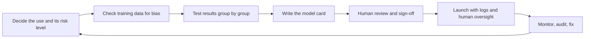

> [!crumbs] [[00 Start Here|🏠 Home]] › [[Part 2 AI System Design|Part 2]] › [[The 12 Ribs]] › Ethics & Governance

> [!tldr] In one sentence
> Ethics and governance means making sure an AI system **treats people fairly, can explain itself, follows the law and has a named human accountable for it**, with checks built in from the start.

## 🧠 Think of it like…

> [!analogy] Food safety in a restaurant
> A good restaurant doesn't only cook tasty food. It labels allergens, keeps fridge logs, passes health inspections, and has a named manager who answers if a guest gets sick.

Tasty food is an accurate model. The allergen label is a **model card**, a short sheet saying what the model is for and where it fails. The logs and inspections are **governance**. The named manager is **accountability**.

## What it is

**Ethics** is the goals. The AI should be fair, meaning it doesn't treat similar people differently because of their group. It should be explainable and accountable.

**Governance** is the machinery that makes those goals real: policies, reviews, sign-offs, documentation, logs and **compliance**, meaning following the laws that apply.

## Why it matters

- **AI learns from the past, unfairness included.** It can repeat old prejudice at scale.[^1]
- **Mistakes land unevenly.** In a 2018 study, commercial face-analysis tools misclassified darker-skinned women up to 34.7% of the time, versus at most 0.8% for lighter-skinned men.[^2]
- **It's the law.** The EU AI Act is the first comprehensive AI law in the world.[^3] Breaking its bans can cost up to €35 million or 7% of worldwide yearly turnover.[^4]

## How it works

The usual loop:

- **Size the risk first.** The EU AI Act sorts uses into four levels. Some are banned, such as social scoring. **High-risk** uses, like sorting job applications or credit scoring, face strict rules. Chatbots must say they're machines; spam filters face no special rules.[^3]
- **Test fairness group by group.** Good averages can hide a group the model fails.[^2]
- **Write it down.** A model card ships with a model. It states the intended use and test results across groups such as age, sex and skin type.[^5]
- **Keep a human in charge.** In Europe, people generally have a right not to face important decisions made only by a machine.[^6] High-risk AI must also keep activity logs and allow human oversight.[^3]
- **Give someone the job.** The US NIST AI Risk Management Framework makes "Govern" part of every step.[^7]

**Explainability** means showing which factors drove a decision.

## A real-world example

From 2014, Amazon built an AI tool that rated job applicants from one to five stars.[^1] It learned from ten years of mostly male résumés. It began marking down résumés containing the word "women's," and graduates of two all-women's colleges.[^1] Engineers removed those terms but couldn't rule out other bias, and Amazon disbanded the team.[^1]

## Myths and pitfalls

- **❌ Myth:** Remove the gender column and the model can't be sexist. **✅ Reality:** Models find stand-ins, like Amazon's tool did with words and college names.[^1]
- **❌ Myth:** A highly accurate model is a fair model. **✅ Reality:** High average accuracy can hide large error gaps between groups.[^2]
- **❌ Myth:** "Fair" has one obvious meaning. **✅ Reality:** There are several reasonable definitions, and they usually can't all be met at once.[^8]
- **❌ Myth:** Ethics is just public relations. **✅ Reality:** Many EU AI Act rules already apply; strict high-risk rules start in December 2027.[^3]

## Check yourself

> [!question]- Why can an AI trained on real past decisions still be unfair?
> Past decisions can contain bias, and the model learns and repeats it at scale.

> [!question]- What does a model card tell you?
> What the model is for, how it was tested and how well it works for different groups.

> [!question]- A bank wants AI to approve loans. Name two governance steps it needs.
> Test approvals group by group, and offer human review of decisions.

## Key terms

- **Bias** — a model systematically treating some groups worse than others.
- **Fairness** — a chosen, measurable standard for treating groups equitably.
- **Explainability** — showing which factors drove an AI decision.
- **Model card** — a short document on a model's intended use, tests and limits.
- **Human oversight** — a person able to check, override or stop an AI decision.
- **EU AI Act** — the European Union's law regulating AI by level of risk.

## 🧱 Builds on

- [[Logging]] — audit trails record what the model saw and decided, so decisions can be traced.
- [[Authorization]] — rules on who may approve, deploy or override a model put a name on each decision.
- [[Requirements]] — fairness, explainability and legal duties are written down before anyone builds.

> [!deepdive] Ready for the technical take?
> Sources of bias, conflicting fairness metrics, SHAP explanations, datasheets and model cards, NIST AI RMF and the EU AI Act timeline.
> → [[Ethics & Governance (Deep Dive)]]

## Related

- [[Guardrails & AI Safety]] — runtime checks that stop harmful outputs.
- [[AI Security & Privacy]] — protecting the personal data AI systems use.
- [[Evaluation & Metrics]] — where group-by-group fairness tests live.
- [[Data Sources]] — biased data in means biased decisions out.

> [!nav] Keep going
> ← [[AI Reliability & Fault Tolerance]] · [[The 12 Ribs|☂️ The 12 Ribs]] · [[Context Engineering]] →
> 🔬 Technical take: [[Ethics & Governance (Deep Dive)]] · 🗺️ [[Glossary]]

## 📚 Sources

[^1]: 📝 [Amazon scraps secret AI recruiting tool that showed bias against women](https://www.euronews.com/2018/10/10/amazon-scraps-secret-ai-recruiting-tool-that-showed-bias-against-women) — Jeffrey Dastin, Reuters (via Euronews), 2018. Article. Checked 2026-11.
[^2]: 🔬 [Gender Shades: Intersectional Accuracy Disparities in Commercial Gender Classification](https://proceedings.mlr.press/v81/buolamwini18a.html) — Buolamwini and Gebru, FAT* 2018 (PMLR 81). Paper. Checked 2026-11.
[^3]: 📄 [AI Act](https://digital-strategy.ec.europa.eu/en/policies/regulatory-framework-ai) — European Commission, Shaping Europe's digital future. Official docs. Checked 2026-11.
[^4]: 📄 [Article 99: Penalties](https://artificialintelligenceact.eu/article/99/) — EU AI Act text, artificialintelligenceact.eu (unofficial explorer). Legal text. Checked 2026-11.
[^5]: 🔬 [Model Cards for Model Reporting](https://arxiv.org/abs/1810.03993) — Mitchell et al., FAT* 2019. Paper. Checked 2026-11.
[^6]: 📄 [Art. 22 GDPR: Automated individual decision-making, including profiling](https://gdpr-info.eu/art-22-gdpr/) — GDPR text, gdpr-info.eu (unofficial consolidation). Legal text. Checked 2026-11.
[^7]: 📄 [5 AI RMF Core](https://airc.nist.gov/airmf-resources/airmf/5-sec-core/) — NIST Trustworthy and Responsible AI Resource Center. Official docs. Checked 2026-11.
[^8]: 🔬 [Inherent Trade-Offs in the Fair Determination of Risk Scores](https://arxiv.org/abs/1609.05807) — Kleinberg, Mullainathan and Raghavan, 2016. Paper. Checked 2026-11.
