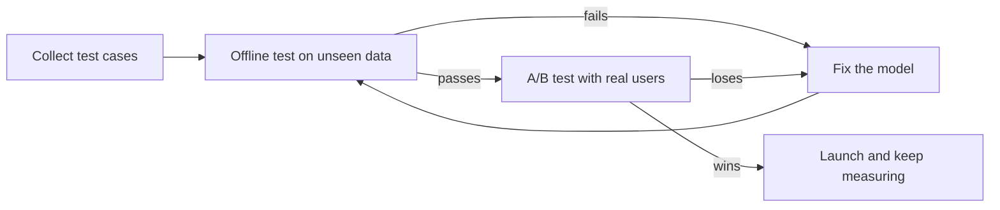

> [!crumbs] [[00 Start Here|🏠 Home]] › [[Part 2 AI System Design|Part 2]] › [[The 12 Ribs]] › Evaluation & Metrics

> [!tldr] In one sentence
> Evaluation is how you **prove an AI model is good enough** for its job: first on questions it has never seen, then with real users.

## 🧠 Think of it like…

> [!analogy] A driving test
> A learner practices for weeks. Then an examiner picks a route the learner has never driven and scores specific skills before handing over a license.

The practice drives are the model's **training data**, the examples it learns from. The exam route is the **test set**, examples kept hidden until the end.

## What it is

Evaluation, often shortened to **evals**, means grading a model's answers. An eval is a test: give the AI an input, then apply grading rules to its output.[^1]

For a yes-or-no model, such as a spam filter, the scores have standard names:[^2]

- **Accuracy** — the share of all answers that were right.
- **Precision** — of the emails flagged as spam, how many really were spam.
- **Recall** — of all the real spam, how much the filter caught.
- **F1** — one score that balances precision and recall.

## Why it matters

- **Accuracy can lie.** If only 1% of emails are spam, a filter that flags nothing is 99% accurate and useless.[^2]
- **Mistakes cost different amounts.** If missing a real case is worst, favor recall. If false alarms are worst, favor precision.[^2]
- **The lab is not the world.** A model can ace its test and still flop if the test data doesn't match real life.[^3]

## How it works

**Offline, before launch.** Teams split their data. The model learns from one part and is graded on a part it has never seen, because grading it on studied examples only tests its memory.[^3]

**Online, after launch.** An **A/B test** shows the current version to one random group of users and the new version to another, then compares what each group does. In 2013 the Bing search engine ran over 200 of these on any given day.[^4]

Chatbots are harder: good answers vary in wording. Teams mix code checks (fast but rigid), human reviewers (best but slow) and **LLM-as-a-judge**, where a strong AI model grades another model's answers.[^1] In one study, the AI model GPT-4 agreed with human judges over 80% of the time, about as often as two humans agree.[^5]

## A real-world example

Chatbot Arena is a public website that ranks chatbots by asking people. You type a question, two anonymous models answer, and you vote for the better reply; the names appear only afterward.[^6]

By January 2024 it had **around 240,000 votes** comparing more than 50 models.[^6] Its creators built it because fixed test sets can leak into training data and stop being a fair exam.[^6] Since January 2026 it is simply called Arena.[^7]

## Myths and pitfalls

- **❌ Myth:** High accuracy means a good model. **✅ Reality:** When one answer is rare, accuracy hides failure. Check precision and recall too.[^2]
- **❌ Myth:** You can reuse one test set forever. **✅ Reality:** Tuning to win on it fits the model to its quirks, like teaching to the test. Refresh it.[^3]
- **❌ Myth:** An AI judge is neutral. **✅ Reality:** AI judges can favor the first answer shown, longer answers, or their own writing.[^5]
- **❌ Myth:** Passing offline tests guarantees a good launch. **✅ Reality:** Many changes move business numbers by about 1%, and the effect is hard to predict. A live experiment settles it.[^4]

## Check yourself

> [!question]- Why is a 99%-accurate fraud detector not necessarily good?
> If 1% of transactions are fraud, flagging nothing scores 99%. Recall shows whether it catches any.

> [!question]- Why keep a test set the model never sees while learning?
> Grading on studied examples only shows memory. Unseen examples show how it handles new cases.

> [!question]- What does an A/B test tell you that an offline test can't?
> How real users behave with the new version, compared fairly against a random group on the old one.

## Key terms

- **Eval** — a test that gives an AI an input and grades its output.
- **Test set** — examples hidden during learning, used for the final grade.
- **Precision** — of the things the model flagged, the share that were right.
- **Recall** — of the things it should have flagged, the share it caught.
- **A/B test** — a live experiment comparing two versions on random groups of users.
- **LLM-as-a-judge** — a strong language model grading another model's answers.

## 🧱 Builds on

- [[Metrics]] — evaluation turns "is the model good?" into numbers you track on a dashboard.
- [[Requirements]] — requirements say which mistakes hurt most, which decides whether you chase precision or recall.

> [!deepdive] Ready for the technical take?
> Thresholds, data leakage, pass@k for agents, judge biases and trustworthy A/B tests.
> → [[Evaluation & Metrics (Deep Dive)]]

## Related

- [[Business Goals & Requirements]] — where the target score comes from.
- [[Model Selection & Training]] — the work evaluation grades.
- [[Deployment & Serving]] — canary and A/B rollouts carry evaluation into production.
- [[AI Monitoring & Observability]] — keeps measuring the model after launch.

> [!nav] Keep going
> ← [[Feature Engineering]] · [[The 12 Ribs|☂️ The 12 Ribs]] · [[Deployment & Serving]] →
> 🔬 Technical take: [[Evaluation & Metrics (Deep Dive)]] · 🗺️ [[Glossary]]

## 📚 Sources

[^1]: 📝 [Demystifying evals for AI agents](https://www.anthropic.com/engineering/demystifying-evals-for-ai-agents) — Anthropic Engineering, January 2026. Engineering blog. Checked 2026-11.
[^2]: 🎓 [Classification: Accuracy, recall, precision, and related metrics](https://developers.google.com/machine-learning/crash-course/classification/accuracy-precision-recall) — Google Machine Learning Crash Course. Course. Checked 2026-11.
[^3]: 🎓 [Datasets: Dividing the original dataset](https://developers.google.com/machine-learning/crash-course/overfitting/dividing-datasets) — Google Machine Learning Crash Course. Course. Checked 2026-11.
[^4]: 🔬 [Online Controlled Experiments at Large Scale](https://exp-platform.com/large-scale/) — Kohavi et al., KDD 2013. Paper. Checked 2026-11.
[^5]: 🔬 [Judging LLM-as-a-Judge with MT-Bench and Chatbot Arena](https://arxiv.org/abs/2306.05685) — Zheng et al., arXiv 2306.05685, 2023. Paper. Checked 2026-11.
[^6]: 🔬 [Chatbot Arena: An Open Platform for Evaluating LLMs by Human Preference](https://ar5iv.labs.arxiv.org/html/2403.04132) — Chiang et al., arXiv 2403.04132, 2024. Paper. Checked 2026-11.
[^7]: 📝 [LMArena is now Arena](https://arena.ai/blog/lmarena-is-now-arena/) — Arena blog, January 2026. Article. Checked 2026-11.
