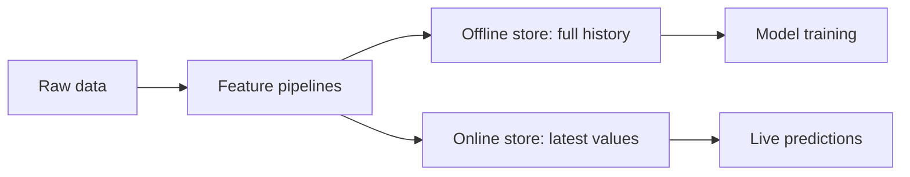

> [!crumbs] [[00 Start Here|🏠 Home]] › [[Part 2 AI System Design|Part 2]] › [[The 12 Ribs]] › Feature Engineering

> [!tldr] In one sentence
> Feature engineering turns raw data into the **clear, numeric signals a model can learn from**, and makes sure they are calculated **the same way in training and in live use**.

## 🧠 Think of it like…

> [!analogy] A chef's prep station
> A recipe never says "add a bag of onions." It says "one cup of diced onion." Before cooking, the kitchen washes, chops and measures everything, and every cook preps it the same way.

Raw data is the bag of groceries. A **feature** is a prepped ingredient: one measured input, like "rides in the last seven days." If the test kitchen dices onions but the restaurant slices them, the dish changes. The same happens when training and live data are prepared differently.

## What it is

A feature is one piece of information a model uses to predict. Feature engineering is choosing and shaping those pieces. Common moves:

- **Scaling numbers** onto a similar range, so a huge value like income doesn't drown out a small one like age.[^1]
- **Turning categories into numbers**, for example giving each city its own on/off slot, called **one-hot encoding**.[^2]
- **Combining features**, so a simple model can spot patterns that only appear together.[^3]

## Why it matters

- **A model only sees what you give it.** Google's ML guide advises starting with features you observe directly, before ones that other models compute.[^4]
- **Consistency beats cleverness.** When training and live predictions see different data, quality drops. This gap is **training-serving skew**.[^4] YouTube's home page team gained significant quality just by training on the exact features saved at serving time.[^4]
- **No peeking at the future.** If a feature uses information that won't exist when you predict, test scores look great and real results flop. This is **data leakage**.[^5]

## How it works

Big teams use a **feature store**, a shared library of ready-made features with two halves.[^6]

- The **offline store** keeps the full history, used to build training data.
- The **online store** keeps only the latest value per customer or item, so a live prediction can fetch it in milliseconds.

The same definition fills both halves, keeping training and serving in step. For training data, the store looks up each value **as it was at that moment in the past**, so future values don't leak in.[^6]

## A real-world example

Uber built a feature store into its Michelangelo platform. It held about **10,000 shared features**, each with an owner and description, reusable by name.[^7] Some were recalculated in daily batches, such as a restaurant's average meal prep time over seven days. Others were updated in near real time from live events, such as the same average over the last hour.[^7] One shared feature language ran at both training and prediction time.[^7]

## Myths and pitfalls

- **❌ Myth:** More features always help. **✅ Reality:** Barely useful features still make a system fragile; a model can break when one disappears.[^8]
- **❌ Myth:** Deep learning makes feature engineering obsolete. **✅ Reality:** Neural networks can learn some combinations themselves, but at a high computing cost.[^3] Freshness and consistency remain your job.
- **❌ Myth:** It's fine to compute averages over all your data. **✅ Reality:** Learn them from training data only. Otherwise the test leaks into training and scores look too good.[^5]

## Check yourself

> [!question]- What is a feature?
> One measurable input a model uses to predict, such as "account age."

> [!question]- Why does a feature store have both an offline and an online half?
> Training needs the full history, while live predictions need the latest value fast. One definition fills both, so they stay consistent.

> [!question]- A churn model uses "cancelled subscription date" as a feature. What is wrong?
> That value only exists after a customer churns, so it leaks the answer. In real use, the model can't see it.

## Key terms

- **Feature** — one measurable input a model uses to predict.
- **One-hot encoding** — turning each category into its own on/off slot.
- **Feature store** — a shared system that computes, stores and serves features.
- **Training-serving skew** — a mismatch between training data and live data.
- **Data leakage** — training on information unavailable at prediction time.
- **Point-in-time correctness** — using each feature's value as it was at that moment.

## 🧱 Builds on

- [[Data Structures]] — features are lists of numbers, often mostly zeros, stored compactly.
- [[Databases]] — the offline store is a big history table; the online store, a fast lookup by ID.
- [[Caching]] — the online store acts as a cache of precomputed values.

> [!deepdive] Ready for the technical take?
> Scaling and encoding, point-in-time joins, skew detection and feature store design at Uber and Airbnb.
> → [[Feature Engineering (Deep Dive)]]

## Related

- [[Data Engineering & Pipelines]] — the pipelines that feed feature computation.
- [[Model Selection & Training]] — the model that uses them.
- [[Embeddings & Vector Databases]] — learned features for text and images.
- [[Deployment & Serving]] — where live features are fetched.
- [[AI Monitoring & Observability]] — spotting features that drift in production.

> [!nav] Keep going
> ← [[Model Selection & Training]] · [[The 12 Ribs|☂️ The 12 Ribs]] · [[Evaluation & Metrics]] →
> 🔬 Technical take: [[Feature Engineering (Deep Dive)]] · 🗺️ [[Glossary]]

## 📚 Sources

[^1]: 🎓 [Numerical data: Normalization](https://developers.google.com/machine-learning/crash-course/numerical-data/normalization) — Google Machine Learning Crash Course. Course. Checked 2026-11.
[^2]: 🎓 [Categorical data: One-hot encoding](https://developers.google.com/machine-learning/crash-course/categorical-data/one-hot-encoding) — Google Machine Learning Crash Course. Course. Checked 2026-11.
[^3]: 🎓 [Categorical data: Feature crosses](https://developers.google.com/machine-learning/crash-course/categorical-data/feature-crosses) — Google Machine Learning Crash Course. Course. Checked 2026-11.
[^4]: 📄 [Rules of Machine Learning](https://developers.google.com/machine-learning/guides/rules-of-ml) — Martin Zinkevich, Google for Developers, Rules #17 and #29. Official docs. Checked 2026-11.
[^5]: 📄 [Common pitfalls and recommended practices](https://scikit-learn.org/stable/common_pitfalls.html) — scikit-learn documentation. Official docs. Checked 2026-11.
[^6]: 📄 [Introduction](https://docs.feast.dev/) — Feast documentation. Official docs. Checked 2026-11.
[^7]: 📝 [Meet Michelangelo: Uber's Machine Learning Platform](https://www.uber.com/blog/michelangelo-machine-learning-platform/) — Uber Engineering, 2017. Engineering blog. Checked 2026-11.
[^8]: 🔬 [Hidden Technical Debt in Machine Learning Systems](https://proceedings.neurips.cc/paper/2015/file/86df7dcfd896fcaf2674f757a2463eba-Paper.pdf) — Sculley et al., Google, NeurIPS 2015, section 3. Paper. Checked 2026-11.
