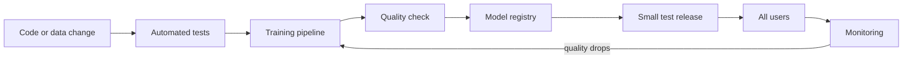

> [!crumbs] [[00 Start Here|🏠 Home]] › [[Part 2 AI System Design|Part 2]] › [[The 12 Ribs]] › MLOps & CI-CD

> [!tldr] In one sentence
> MLOps is the habit of **automating how models are built, tested, stored and released**, so a new model can reach users safely and repeatably instead of by hand.

## 🧠 Think of it like…

> [!analogy] A bakery's production line
> A home baker makes one great cake by feel. A bakery must make the same cake every day, check each batch, label it with a date, and pull a bad batch off the shelves fast.

The home cake is a model a researcher built once by hand. The bakery line is MLOps: written recipes, automatic checks, a labeled storeroom of past batches, and a fast way back to yesterday's batch.

## What it is

**MLOps** (machine learning operations) means automating and monitoring every step from raw data to a live model.[^1] Its core tool is **CI/CD**: automatically testing every change (continuous integration), then shipping it safely (continuous delivery).

A normal app changes only when its code changes. An ML system changes when the **code**, the **data** or the **model** changes, so all three need versions and tests.[^2]

MLOps also adds **continuous training**: retraining automatically when new data arrives or quality drops.[^1] For chatbot-style apps this is often called **LLMOps**, and prompts get versioned and tested too.[^3]

## Why it matters

- **The model is the small part.** Google engineers showed the learning code is a tiny box inside a real ML system, surrounded by much more.[^4]
- **Models go stale.** The world changes, so a forgotten model slowly gets worse.[^1]
- **Manual hand-offs are slow.** When a model file passes by hand from scientist to engineer, new versions ship only a couple of times a year.[^1]

## How it works

1. **Test.** Every change runs automatic checks on code, data and model.[^1]
2. **Train in a pipeline.** A **pipeline** is a scripted series of steps (get data, check it, train, evaluate) that runs the same way every time.[^1]
3. **Gate on quality.** The new model must beat the one already live before it moves on.[^1]
4. **Register it.** A **model registry** is a labeled shelf of every model version, with notes on how each was made.[^5]
5. **Release gradually.** A **canary release** sends a small slice of traffic to the new model first. If alarms fire, traffic rolls back automatically.[^6]
6. **Watch and repeat.** Monitoring spots decline and kicks off retraining.[^1]

## A real-world example

Uber built Michelangelo, an internal platform for building and running models. By 2018, **thousands of models** ran on it, making millions of predictions every second.[^7] Every model is versioned and reproducible, and teams deploy with a click.[^7]

## Myths and pitfalls

- **❌ Myth:** MLOps is normal software releasing with a model file added. **✅ Reality:** You also test data and retrain automatically, which normal software never needs.[^1]
- **❌ Myth:** A better score in the lab means a better product. **✅ Reality:** Offline scores are only an estimate. A gradual release tests the model on real traffic.[^1][^6]
- **❌ Myth:** Retraining means someone remembers to click a button. **✅ Reality:** It can start by itself on a schedule, when new data lands, or when quality or the input data drifts.[^1]

## Check yourself

> [!question]- What are the three things that can change an ML system?
> The code, the model and the data. Each needs its own versioning and tests.

> [!question]- What does a model registry give you that a shared folder does not?
> Numbered versions, notes on how each was trained, and movable labels such as "champion" for promoting or rolling back.

> [!question]- Why release a new model to a small slice of users first?
> So a hidden problem hits only a few users, and an alarm can roll traffic back first.

## Key terms

- **MLOps** — automating and monitoring the whole life of a model, from data to live service.
- **CI/CD** — automatically testing every change, then shipping it safely.
- **Continuous training** — retraining a model automatically on a schedule, on new data, or when quality drops.
- **ML pipeline** — a scripted, repeatable series of steps that turns data into a model.
- **Model registry** — a catalog of model versions with their history and labels.
- **Canary release** — giving a new version a small share of traffic first.
- **LLMOps** — the same practices for LLM apps, including versioning and testing prompts.

## 🧱 Builds on

- [[Microservices]] — the model usually ships as its own service, released on its own schedule.
- [[Fault Tolerance]] — canary releases, health alarms and instant rollback keep a bad model from taking the product down.

> [!deepdive] Ready for the technical take?
> Google's three MLOps maturity levels, retraining triggers, the ML Test Score, registry aliases and canary versus linear rollouts.
> → [[MLOps & CI-CD (Deep Dive)]]

## Related

- [[AI Monitoring & Observability]] — the alerts that trigger retraining.
- [[Model Selection & Training]] — what the training pipeline actually runs.
- [[Deployment & Serving]] — where the released model lives.
- [[Evaluation & Metrics]] — the quality gate every new model must pass.
- [[Data Engineering & Pipelines]] — the data side of the same automation.

> [!nav] Keep going
> ← [[AI Monitoring & Observability]] · [[The 12 Ribs|☂️ The 12 Ribs]] · [[AI Security & Privacy]] →
> 🔬 Technical take: [[MLOps & CI-CD (Deep Dive)]] · 🗺️ [[Glossary]]

## 📚 Sources

[^1]: 📄 [MLOps: Continuous delivery and automation pipelines in machine learning](https://docs.cloud.google.com/architecture/mlops-continuous-delivery-and-automation-pipelines-in-machine-learning) — Google Cloud Architecture Center. Official docs. Checked 2026-11.
[^2]: 📝 [Continuous Delivery for Machine Learning](https://www.martinfowler.com/articles/cd4ml.html) — Danilo Sato et al., martinfowler.com. Article. Checked 2026-11.
[^3]: 📄 [Evaluate and compare prompt versions](https://docs.databricks.com/aws/mlflow3/genai/prompt-version-mgmt/prompt-registry/evaluate-prompts) — Databricks documentation. Official docs. Checked 2026-11.
[^4]: 🔬 [Hidden Technical Debt in Machine Learning Systems](https://proceedings.neurips.cc/paper_files/paper/2015/file/86df7dcfd896fcaf2674f757a2463eba-Paper.pdf) — Sculley et al., NeurIPS 2015. Paper. Checked 2026-11.
[^5]: 📄 [MLflow Model Registry](https://mlflow.org/docs/latest/ml/model-registry) — MLflow documentation. Official docs. Checked 2026-11.
[^6]: 📄 [Blue/Green Deployments](https://docs.aws.amazon.com/sagemaker/latest/dg/deployment-guardrails-blue-green.html) — Amazon SageMaker AI Developer Guide. Official docs. Checked 2026-11.
[^7]: 📝 [Scaling Machine Learning at Uber with Michelangelo](https://www.uber.com/blog/scaling-michelangelo/) — Uber Engineering, 2018. Engineering blog. Checked 2026-11.
