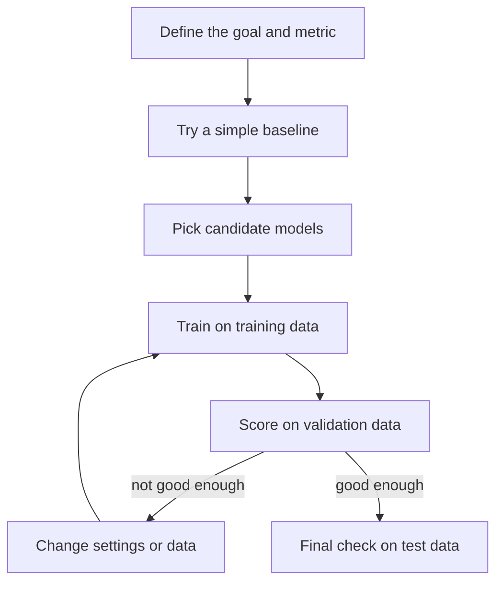

> [!crumbs] [[00 Start Here|🏠 Home]] › [[Part 2 AI System Design|Part 2]] › [[The 12 Ribs]] › Model Selection & Training

> [!tldr] In one sentence
> Model selection is picking the AI model that fits your problem and budget; training is showing it examples until it learns the pattern. Most teams now **start from a pre-trained model and adapt it** instead of building one from scratch.

## 🧠 Think of it like…

> [!analogy] Hiring for a job
> You can hire a beginner and train them for years, or hire a professional and give them a week of onboarding. Or you can hand a capable temp clear instructions. Either way, you judge them on work they haven't seen before.

Training from scratch is the beginner. **Fine-tuning** is the onboarding: a model with general skills gets a short course on your task. A good prompt is the instruction sheet. The final exam is a **test set** of examples the model never saw.

## What it is

A model is a program that learns patterns from examples instead of following hand-written rules. **Training** nudges its internal numbers, called parameters, until its mistakes shrink.[^1]

Before training, you choose **hyperparameters**: settings such as how big each learning step is and how many times the model reads the data.[^1] Model selection means comparing options, from a simple formula to a large pre-trained network, and keeping the best fit.

## Why it matters

- **Simple first.** Google's ML guide says don't fear launching without machine learning, and keep the first model simple while getting the plumbing right.[^2]
- **Cost.** Big models are expensive. Meta trained Llama 3 on two clusters, each with about 24,000 GPUs (chips built for this math).[^3] You rarely need that.
- **Reuse.** **Transfer learning**, reusing what a model learned on one problem for a similar one, works even with little data of your own.[^4]

## How it works

You split your data into three piles. The model learns from the **training set**, you tune it against a **validation set**, and lock away a **test set** as a stand-in for the real world.[^5] If a model scores well on training data but badly on new data, it is **overfitting**: memorizing answers instead of learning the pattern.[^5]

Each attempt is an experiment, so teams log every run's settings, scores and model file. Tools like MLflow do this automatically.[^6]

For language models, there is a ladder. Write better prompts first. Add retrieval, fetching documents for the model to read, if it lacks knowledge. Fine-tune only if it still behaves inconsistently.[^7]

## A real-world example

Meta's Llama 3, released in April 2024, was pre-trained on more than **15 trillion tokens** (word pieces) of public text.[^3] A popular rule of thumb says an 8-billion-parameter model needs only about 200 billion tokens, yet Meta's models kept improving far past that.[^3] Meta then fine-tuned them on instructions and human preference data to make them useful assistants.[^3]

## Myths and pitfalls

- **❌ Myth:** The biggest model always wins. **✅ Reality:** Chinchilla, at 70 billion parameters, beat the 280-billion-parameter Gopher on the same compute budget by training on about four times more data.[^8]
- **❌ Myth:** You need your own model. **✅ Reality:** Prompting is usually the best place to start, and sometimes it is all you need.[^7]
- **❌ Myth:** Fine-tuning means retraining the whole model. **✅ Reality:** Methods like LoRA train small add-on pieces and cut trainable parameters by up to 10,000 times.[^9]

## Check yourself

> [!question]- Why keep a test set the model never sees during training?
> It stands in for real-world data. Scoring on data the model already learned from would hide overfitting.

> [!question]- What is the difference between a parameter and a hyperparameter?
> Parameters are the numbers the model learns. Hyperparameters are settings you choose before training, like the learning step size.

> [!question]- A support team wants a chatbot that answers in their house style. Where should they start?
> With better prompts and a set of test questions. Fine-tune only if the style stays inconsistent.

## Key terms

- **Training** — adjusting a model's numbers so its mistakes shrink.
- **Hyperparameter** — a setting chosen before training, like learning rate.
- **Overfitting** — memorizing examples instead of learning the pattern.
- **Transfer learning** — reusing a model trained on one task for a related one.
- **Fine-tuning** — a short extra round of training on your own data.
- **Experiment tracking** — logging each run's settings and results.

## 🧱 Builds on

- [[Trade-offs]] — every model choice trades accuracy against cost and speed.
- [[Estimation]] — quick math on GPU hours and memory before a training run.
- [[Concurrency]] — big training jobs split work across many GPUs at once.

> [!deepdive] Ready for the technical take?
> The prompt-to-pretrain ladder, LoRA, hyperparameter search, compute math and distributed training.
> → [[Model Selection & Training (Deep Dive)]]

## Related

- [[AI Model Types]] — the menu you select from.
- [[Data Engineering & Pipelines]] — supplies the training data.
- [[Feature Engineering]] — shapes what the model learns from.
- [[Evaluation & Metrics]] — how you judge a model.
- [[MLOps & CI-CD]] — retrains and ships models automatically.

> [!nav] Keep going
> ← [[Data Engineering & Pipelines]] · [[The 12 Ribs|☂️ The 12 Ribs]] · [[Feature Engineering]] →
> 🔬 Technical take: [[Model Selection & Training (Deep Dive)]] · 🗺️ [[Glossary]]

## 📚 Sources

[^1]: 🎓 [Linear regression: Hyperparameters](https://developers.google.com/machine-learning/crash-course/linear-regression/hyperparameters) — Google Machine Learning Crash Course. Course. Checked 2026-11.
[^2]: 📄 [Rules of Machine Learning](https://developers.google.com/machine-learning/guides/rules-of-ml) — Martin Zinkevich, Google for Developers, Rules #1 and #4. Official docs. Checked 2026-11.
[^3]: 📝 [Introducing Meta Llama 3](https://ai.meta.com/blog/meta-llama-3/) — Meta AI, April 2024. Engineering blog. Checked 2026-11.
[^4]: 📄 [Transfer learning & fine-tuning](https://keras.io/guides/transfer_learning/) — Keras developer guides. Official docs. Checked 2026-11.
[^5]: 🎓 [Overfitting](https://developers.google.com/machine-learning/crash-course/overfitting/overfitting) — Google Machine Learning Crash Course. Course. Checked 2026-11.
[^6]: 📄 [MLflow Tracking](https://mlflow.org/docs/latest/ml/tracking/) — MLflow documentation. Official docs. Checked 2026-11.
[^7]: 📄 [Optimizing LLM Accuracy](https://developers.openai.com/api/docs/guides/optimizing-llm-accuracy) — OpenAI API documentation. Official docs. Checked 2026-11.
[^8]: 🔬 [Training Compute-Optimal Large Language Models](https://arxiv.org/abs/2203.15556) — Hoffmann et al., arXiv 2022. Paper. Checked 2026-11.
[^9]: 🔬 [LoRA: Low-Rank Adaptation of Large Language Models](https://arxiv.org/abs/2106.09685) — Hu et al., arXiv 2021. Paper. Checked 2026-11.
