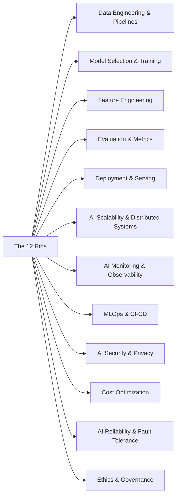

> [!crumbs] [[00 Start Here|🏠 Home]] › [[Part 2 AI System Design|Part 2]] › The 12 Ribs

> [!hub] ☂️ The 12 Ribs
> The twelve concerns that together hold up any AI system, numbered as on the umbrella.

On the umbrella, each rib is one concern. Take any rib away and the canopy sags: a system with great models but no monitoring, or great serving but no cost control, fails in production. The numbers follow the image, from data on the left to governance on the right.

## Topics

| # | Topic | In one line | Technical take |
| --- | --- | --- | --- |
| **1** | [[Data Engineering & Pipelines]] | Moving and cleaning data so models get a steady, trustworthy supply. | [[Data Engineering & Pipelines (Deep Dive)\|🔬 Deep dive]] |
| **2** | [[Model Selection & Training]] | Choosing the right model and teaching it from data. | [[Model Selection & Training (Deep Dive)\|🔬 Deep dive]] |
| **3** | [[Feature Engineering]] | Turning raw data into the signals a model can learn from. | [[Feature Engineering (Deep Dive)\|🔬 Deep dive]] |
| **4** | [[Evaluation & Metrics]] | Measuring whether a model is actually good, before and after launch. | [[Evaluation & Metrics (Deep Dive)\|🔬 Deep dive]] |
| **5** | [[Deployment & Serving]] | Putting a trained model where users and apps can call it. | [[Deployment & Serving (Deep Dive)\|🔬 Deep dive]] |
| **6** | [[AI Scalability & Distributed Systems]] | Spreading AI training and serving across many machines and chips. | [[AI Scalability & Distributed Systems (Deep Dive)\|🔬 Deep dive]] |
| **7** | [[AI Monitoring & Observability]] | Watching a live model for quality drops, drift and surprises. | [[AI Monitoring & Observability (Deep Dive)\|🔬 Deep dive]] |
| **8** | [[MLOps & CI-CD]] | Automating how models are built, tested, versioned and shipped. | [[MLOps & CI-CD (Deep Dive)\|🔬 Deep dive]] |
| **9** | [[AI Security & Privacy]] | Protecting models, data and users from attacks and leaks. | [[AI Security & Privacy (Deep Dive)\|🔬 Deep dive]] |
| **10** | [[Cost Optimization]] | Getting the same results for less money. | [[Cost Optimization (Deep Dive)\|🔬 Deep dive]] |
| **11** | [[AI Reliability & Fault Tolerance]] | Keeping AI features working when models, GPUs or providers fail. | [[AI Reliability & Fault Tolerance (Deep Dive)\|🔬 Deep dive]] |
| **12** | [[Ethics & Governance]] | Making AI fair, explainable, lawful and accountable. | [[Ethics & Governance (Deep Dive)\|🔬 Deep dive]] |

## The shape of it

> [!tip] How to read these
> Every topic has a **🌱 basics** note (no jargon, about 5 minutes) and a **🔬 deep dive** (the technical take). Start with the basics; open the deep dive when you want more.
