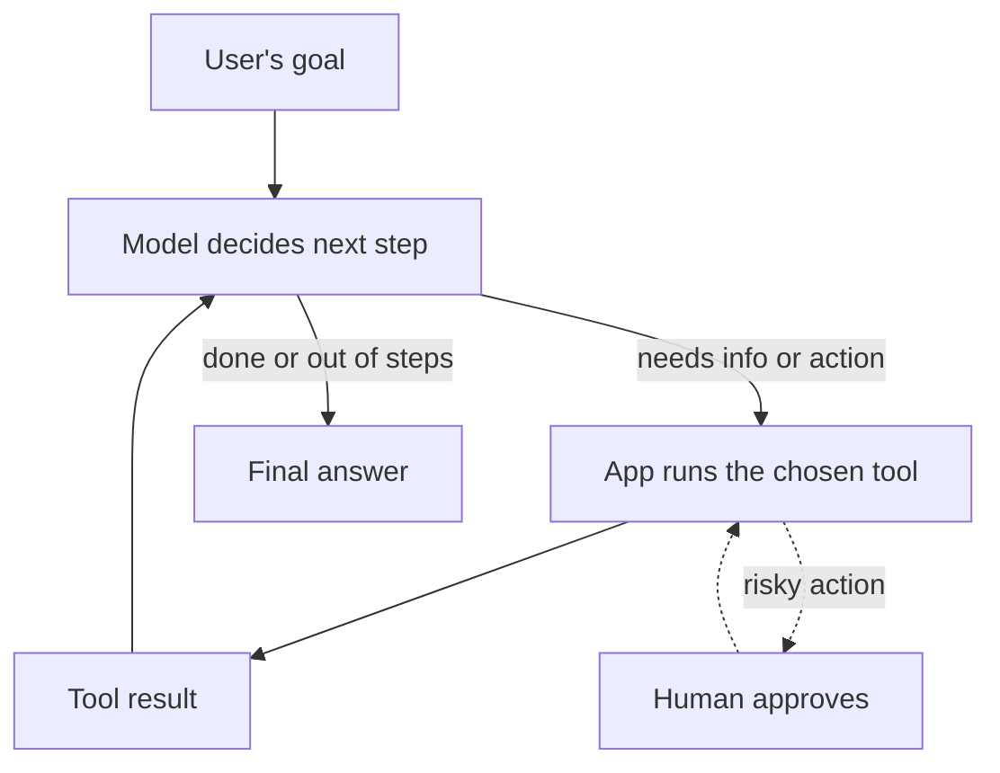

> [!crumbs] [[00 Start Here|🏠 Home]] › [[Part 2 AI System Design|Part 2]] › [[Modern LLM Systems]] › AI Agents & Tool Use

> [!tldr] In one sentence
> An AI agent is a language model that works in a loop: it **decides which tool to use, sees the result, and picks the next step** until the job is done.

## 🧠 Think of it like…

> [!analogy] A capable new assistant with a ring of keys
> You ask a new assistant to "sort out the Henderson invoice." They open the billing system, read the invoice, check an email, then come back with a fix. They can only open the doors you gave them keys to.

The assistant is the **AI model**. The keys are its **tools**: named actions such as "search orders." The assistant chooses which door to open next, but you decide which keys it carries.

## What it is

A **large language model (LLM)** on its own only writes text. **Tool use**, also called **function calling**, lets it ask your app to do something real. You describe each tool: its name, what it does and what inputs it needs. The model replies with a request to use one. **Your code runs the tool** and sends the result back.[^1]

An **agent** repeats that cycle. It plans, acts, looks at what happened and adjusts, until it reaches the goal or a stopping rule.[^2]

Anthropic separates two kinds of systems:[^2]

- **Workflows** follow steps a developer wrote in advance. The model fills in each step.
- **Agents** let the model choose its own steps and tools as it goes.

## Why it matters

- **Real answers, not guesses.** A model that can look things up gets facts from live systems.[^2]
- **Open-ended tasks.** Agents suit jobs whose number of steps nobody can predict.[^2]
- **A standard plug.** The **Model Context Protocol (MCP)** is an open standard for connecting AI apps to tools and data, likened to a USB-C port for AI.[^3]

## How it works

Each turn through the loop works like this:[^1]

1. Your app sends the goal plus a list of allowed tools.
2. The model either answers or asks for a tool call with specific inputs.
3. Your app checks the request, runs the tool and returns the result.
4. The model reads the result and decides again.

In a **multi-agent** setup, a lead agent hands pieces of a big job to helper agents that run side by side.[^4]

## A real-world example

Anthropic's Research feature in Claude uses a lead agent that spawns helper agents to search the web in parallel. On Anthropic's internal research test, this team of agents **beat a single agent by 90.2%**.[^4] The cost: about **15 times the tokens**, the billed chunks of text, of a normal chat.[^4]

## Myths and pitfalls

- **❌ Myth:** The AI runs the tools itself. **✅ Reality:** For your own tools, the model only asks. Your code decides whether to run them and how.[^1][^5]
- **❌ Myth:** Every AI feature should be an agent. **✅ Reality:** Start with the simplest thing that works. Agents trade speed and cost for flexibility.[^2]
- **❌ Myth:** An agent can be trusted with any access. **✅ Reality:** Give it only the tools and permissions the task needs, and require a human to approve high-impact actions.[^6]

## Check yourself

> [!question]- What is the difference between a workflow and an agent?
> In a workflow, a developer fixes the steps in advance. In an agent, the model chooses its own steps and tools as it goes.

> [!question]- When the model "calls a tool," who actually runs it?
> Your application does. The model only produces a structured request.

> [!question]- An email-summarizing agent can also send email. Why is that risky?
> A malicious email could trick it into forwarding private messages.

## Key terms

- **AI agent** — a model that picks actions in a loop to reach a goal.
- **Tool** — a named action, with described inputs, that a model can ask an app to run.
- **Function calling** — the model replying with a structured request to run a tool.
- **MCP (Model Context Protocol)** — an open standard for plugging tools and data into AI apps.
- **Multi-agent system** — several agents splitting one task.
- **Human in the loop** — a person approving key steps before the agent proceeds.

## 🧱 Builds on

- [[API Design]] — each tool is a small API with a name, inputs and outputs the model must understand.
- [[Authorization]] — an agent should act with the least access the task needs.
- [[Fault Tolerance]] — long agent runs need retries and restart points when a step fails.
- [[Message Queues]] — long or parallel agent tasks are often handed off and picked up later.

> [!deepdive] Ready for the technical take?
> The tool-call protocol, workflow patterns, MCP, multi-agent costs and production failures.
> → [[AI Agents & Tool Use (Deep Dive)]]

## Related

- [[Context Engineering]] — an agent rebuilds its context on every loop.
- [[Retrieval-Augmented Generation]] — search is the most common agent tool.
- [[Guardrails & AI Safety]] — checks that keep agent actions safe.

> [!nav] Keep going
> ← [[LLM Inference & Optimization]] · [[Modern LLM Systems|🤖 Modern LLM Systems]] · [[Guardrails & AI Safety]] →
> 🔬 Technical take: [[AI Agents & Tool Use (Deep Dive)]] · 🗺️ [[Glossary]]

## 📚 Sources

[^1]: 📄 [Tool use with Claude](https://platform.claude.com/docs/en/agents-and-tools/tool-use/overview) — Anthropic, Claude API documentation. Official docs. Checked 2026-11.
[^2]: 📝 [Building effective agents](https://www.anthropic.com/engineering/building-effective-agents) — Anthropic Engineering, 2024. Engineering blog. Checked 2026-11.
[^3]: 📄 [What is the Model Context Protocol (MCP)?](https://modelcontextprotocol.io/docs/getting-started/intro) — Model Context Protocol documentation. Official docs. Checked 2026-11.
[^4]: 📝 [How we built our multi-agent research system](https://www.anthropic.com/engineering/multi-agent-research-system) — Anthropic Engineering, 2025. Engineering blog. Checked 2026-11.
[^5]: 📄 [Function calling](https://developers.openai.com/api/docs/guides/function-calling) — OpenAI API documentation. Official docs. Checked 2026-11.
[^6]: 📄 [LLM06:2025 Excessive Agency](https://genai.owasp.org/llmrisk/llm062025-excessive-agency/) — OWASP Gen AI Security Project. Standard. Checked 2026-11.
