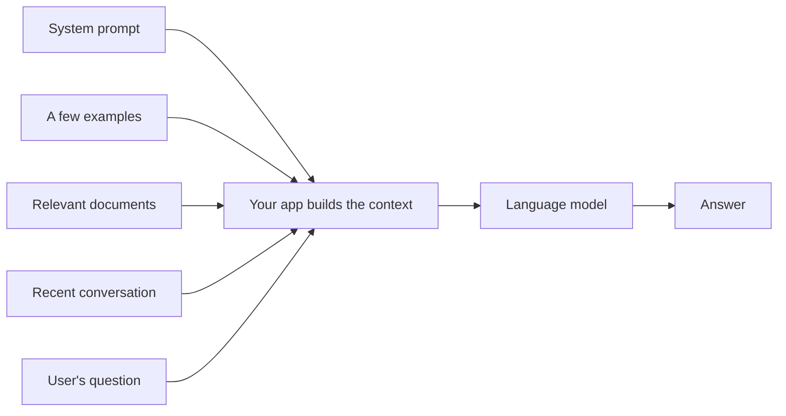

> [!crumbs] [[00 Start Here|🏠 Home]] › [[Part 2 AI System Design|Part 2]] › [[Modern LLM Systems]] › Context Engineering

> [!tldr] In one sentence
> Context engineering means choosing **exactly what goes into an AI model's input**, so it has what it needs to answer well and nothing that distracts it.

## 🧠 Think of it like…

> [!analogy] Briefing a brilliant temp
> A sharp temp joins for one day and knows nothing about your company. Whatever you leave on their desk is all they have. A clear brief, the right files and two examples lead to great work. Dump every folder on the desk, and they miss the one page that mattered.

The AI model is the temp. The desk is the **context window**: the fixed amount of text a model can read in one go. Every request clears the desk and sets it up again.

## What it is

A **large language model (LLM)**, the kind of AI behind chatbots, works from two things only: what it learned in training, and the text sent with your request. That text is the **context**.[^1] It can hold:

- A **system prompt**: standing instructions, like "You are an airline support agent."
- A few examples of good answers, a trick called **few-shot prompting**.[^2]
- Documents, earlier messages, tool results and tool descriptions.

Models count all of this in **tokens**, chunks of text about the size of a short word. **Prompt engineering** is writing good instructions. **Context engineering** is the bigger job: deciding what the whole input holds, every time the model runs.[^3]

## Why it matters

- **Space is limited.** Instructions, documents, history and even the model's own answer all count toward the window.[^1]
- **More is not better.** As inputs grow, models get worse at using what is inside them. This is called **context rot**.[^4]
- **Position matters.** In one study, models used a fact best at the start or end of a long input and worst in the middle.[^5]
- **Cost.** You pay for every token read, so lean is cheaper and faster.

## How it works

Good teams follow a few habits when assembling the context:

- **Start small.** Add instructions only when the model goes wrong.[^3]
- **Show, don't list.** A few varied examples beat a long list of rules.[^3]
- **Fetch just in time.** Let the model look things up when needed, not all up front.[^3]
- **Summarize old history.** When a chat nears the limit, replace old turns with a short summary, called **compaction**.[^3]
- **Reuse the fixed part.** If every request starts the same way, **prompt caching** lets the provider skip re-reading it, cutting cost and wait.[^6]

## A real-world example

Anthropic's coding assistant, Claude Code, loads a short project notes file up front and finds other files with search tools, never reading the whole codebase.[^3] When a session grows long, it keeps a summary of key decisions and open bugs plus the five files it used most recently.[^3]

## Myths and pitfalls

- **❌ Myth:** A huge context window means you can paste in everything. **✅ Reality:** Accuracy drops as inputs grow, even on simple tasks.[^4]
- **❌ Myth:** The model remembers your last conversation. **✅ Reality:** It sees only this request; your app resends past messages.[^1]
- **❌ Myth:** Good prompts depend on magic words. **✅ Reality:** Clear instructions, reasons and examples matter more.[^7]
- **❌ Myth:** Caching a prompt changes the answer. **✅ Reality:** It only skips repeated reading work. The output is the same.[^6]

## Check yourself

> [!question]- How is context engineering different from prompt engineering?
> Prompt engineering is writing instructions. Context engineering decides everything the model sees on each call.

> [!question]- Why not just send the model every document you have?
> Models get less accurate as inputs grow, and extra text costs money and time.

> [!question]- Every request repeats the same long instructions. How do you save money?
> Keep that part identical and at the very start, so prompt caching can reuse it.

## Key terms

- **Context window** — the most text a model can handle at once, answer included.
- **Token** — a small chunk of text, roughly a short word, that models count and charge by.
- **System prompt** — standing instructions that set the model's role and rules.
- **Few-shot prompting** — giving a few worked examples for the model to copy.
- **Context rot** — the drop in accuracy as the input gets longer.
- **Prompt caching** — reusing the work of reading an identical start of the input.

## 🧱 Builds on

- [[API Design]] — every model call is an API request, and the context is its payload.
- [[Caching]] — prompt caching applies the "keep a ready copy" idea to the repeated start of a prompt.

> [!deepdive] Ready for the technical take?
> Attention budgets and context rot, how to order a prompt, just-in-time retrieval, compaction and sub-agents, and the economics of prompt caching.
> → [[Context Engineering (Deep Dive)]]

## Related

- [[Retrieval-Augmented Generation]] — filling the context with the right documents.
- [[Embeddings & Vector Databases]] — finding those documents by meaning.
- [[AI Agents & Tool Use]] — agents rebuild their context on every step.
- [[Guardrails & AI Safety]] — text in the context can also carry attacks.

> [!nav] Keep going
> ← [[Ethics & Governance]] · [[Modern LLM Systems|🤖 Modern LLM Systems]] · [[Embeddings & Vector Databases]] →
> 🔬 Technical take: [[Context Engineering (Deep Dive)]] · 🗺️ [[Glossary]]

## 📚 Sources

[^1]: 📄 [Context windows](https://platform.claude.com/docs/en/build-with-claude/context-windows) — Anthropic, Claude API documentation. Official docs. Checked 2026-11.
[^2]: 🔬 [Language Models are Few-Shot Learners](https://arxiv.org/abs/2005.14165) — Brown et al., OpenAI, 2020. Paper. Checked 2026-11.
[^3]: 📝 [Effective context engineering for AI agents](https://www.anthropic.com/engineering/effective-context-engineering-for-ai-agents) — Anthropic Engineering, 2025. Engineering blog. Checked 2026-11.
[^4]: 📝 [Context Rot: How Increasing Input Tokens Impacts LLM Performance](https://www.trychroma.com/research/context-rot) — Hong, Troynikov and Huber, Chroma, 2025. Technical report. Checked 2026-11.
[^5]: 🔬 [Lost in the Middle: How Language Models Use Long Contexts](https://arxiv.org/abs/2307.03172) — Liu et al., TACL 2023. Paper. Checked 2026-11.
[^6]: 📄 [Prompt caching](https://platform.claude.com/docs/en/build-with-claude/prompt-caching) — Anthropic, Claude API documentation. Official docs. Checked 2026-11.
[^7]: 📄 [Prompting best practices](https://platform.claude.com/docs/en/build-with-claude/prompt-engineering/claude-prompting-best-practices) — Anthropic, Claude API documentation. Official docs. Checked 2026-11.
