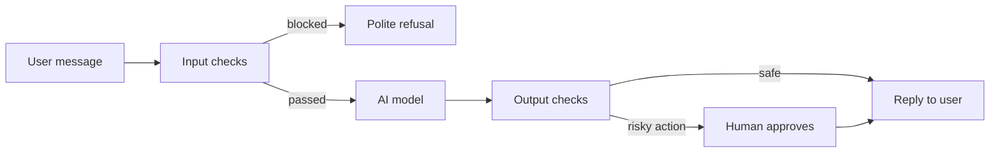

> [!crumbs] [[00 Start Here|🏠 Home]] › [[Part 2 AI System Design|Part 2]] › [[Modern LLM Systems]] › Guardrails & AI Safety

> [!tldr] In one sentence
> Guardrails are **checks placed around an AI model**, on what goes in and what comes out, so a mistake or an attack is caught before it reaches a user or does real harm.

## 🧠 Think of it like…

> [!analogy] A newspaper's safety net
> A reporter writes fast but sometimes gets facts wrong. The mailroom screens suspicious letters, an editor checks every story before print, and legal signs off on risky ones.

The reporter is the **AI model**. The mailroom is an **input check**, the editor is an **output check**, and the legal sign-off is a **human in the loop**: a person who approves important actions before they happen.

## What it is

A **guardrail** is any control outside the model that limits what it sees, says or does. Common ones:

- **Content moderation.** A filter that scores text or images for harm, such as hate or violence.[^1]
- **Attack detection.** A check for **jailbreaks**, which are messages crafted to trick the model into ignoring its rules.[^2]
- **Grounding checks.** Tests that an answer is backed by real sources rather than invented.
- **Action limits.** Rules on which tools an AI may use and which steps need a person's approval.[^2]

**AI safety** is the wider goal: systems that are accurate, secure and hard to misuse.

## Why it matters

- **Models make things up.** A model can state false information with total confidence. Experts call this a **hallucination**, or "confabulation."[^3]
- **Models can be tricked.** **Prompt injection** means hidden instructions in a message, web page or file that hijack the model.[^2] There may be no foolproof fix, so you need layers.[^2]
- **Companies are accountable.** In one ruling, a tribunal treated a chatbot's words as the company's own.[^4]

## How it works

A typical setup layers several checks:

1. **Screen the input.** Catch jailbreaks and harmful requests early.[^2]
2. **Constrain the model.** Give it a clear role and limits, and only the tools its job needs.[^2]
3. **Check the output.** Run a moderation filter, check the format, and test facts against trusted sources.[^1][^2]
4. **Gate the big actions.** A person approves anything costly or irreversible, like a refund.[^2]
5. **Log and watch.** Record what was blocked and why.

Layers work. In Anthropic tests of input and output filters called Constitutional Classifiers, jailbreak success fell from **86% to 4.4%**.[^5]

## A real-world example

In 2022, a grieving passenger asked Air Canada's chatbot about bereavement discounts. The chatbot said he could claim the discount within 90 days after flying. The airline's real policy did not allow that.[^4] Air Canada argued the chatbot was a "separate legal entity." A Canadian tribunal disagreed, found the airline liable for **negligent misrepresentation**, and ordered it to pay the promised refund.[^4][^6]

## Myths and pitfalls

- **❌ Myth:** A well-written prompt is enough to keep the model safe. **✅ Reality:** No foolproof defense against prompt injection is known. Prompts are one layer.[^2]
- **❌ Myth:** A guardrail that stops 95% of attacks is good enough. **✅ Reality:** In web security, 95% is a failing grade. Attackers only need the attempts that get through.[^7]
- **❌ Myth:** Hallucinations can be switched off. **✅ Reality:** Grounding in sources and letting the model say "I don't know" reduce them a lot, but never to zero.[^8]

## Check yourself

> [!question]- What is the difference between an input check and an output check?
> An input check screens what the user sends before the model sees it. An output check reviews the model's answer before anyone sees it or any action runs.

> [!question]- Why put a human in the loop for some actions but not all?
> People are slow and costly. Save them for actions that are expensive or impossible to undo.

> [!question]- A chatbot invents a refund rule. Who is responsible?
> The company that runs it. In the Air Canada case, the tribunal treated the chatbot as part of the airline's website.

## Key terms

- **Guardrail** — a check outside the model that limits what it sees, says or does.
- **Content moderation** — automatically flagging harmful text or images.
- **Hallucination** — a confident answer that is false or made up.
- **Jailbreak** — a message designed to make a model ignore its safety rules.
- **Prompt injection** — hidden instructions in text the model reads that hijack its behavior.
- **Human in the loop** — a person who must approve certain steps.

## 🧱 Builds on

- [[Rate Limiting]] — capping requests and actions slows attackers and limits damage.
- [[Authorization]] — the system, not the model, decides what each user and tool may do.
- [[Logging]] — records of blocked and allowed messages let teams audit and improve.

> [!deepdive] Ready for the technical take?
> Threat taxonomies, rail architectures, classifier numbers, the lethal trifecta and failure modes.
> → [[Guardrails & AI Safety (Deep Dive)]]

## Related

- [[AI Security & Privacy]] — the wider security picture for AI systems.
- [[Ethics & Governance]] — the policies guardrails enforce.
- [[AI Agents & Tool Use]] — agents that take actions need the strongest guardrails.
- [[Retrieval-Augmented Generation]] — grounding answers in documents cuts hallucinations.

> [!nav] Keep going
> ← [[AI Agents & Tool Use]] · [[Modern LLM Systems|🤖 Modern LLM Systems]] · [[Capstone - AI Support Assistant]] →
> 🔬 Technical take: [[Guardrails & AI Safety (Deep Dive)]] · 🗺️ [[Glossary]]

## 📚 Sources

[^1]: 📄 [Moderation](https://developers.openai.com/api/docs/guides/moderation) — OpenAI API documentation. Official docs. Checked 2026-11.
[^2]: 📄 [LLM01:2025 Prompt Injection](https://genai.owasp.org/llmrisk/llm01-prompt-injection/) — OWASP Gen AI Security Project. Standard. Checked 2026-11.
[^3]: 📄 [Artificial Intelligence Risk Management Framework: Generative Artificial Intelligence Profile (NIST AI 600-1)](https://nvlpubs.nist.gov/nistpubs/ai/NIST.AI.600-1.pdf) — NIST, 2024. Standard. Checked 2026-11.
[^4]: 📝 [Air Canada must pay refund promised by AI chatbot, tribunal rules](https://ca.news.yahoo.com/air-canada-must-pay-refund-040527669.html) — The Hill, via Yahoo News Canada, 2024. Article. Checked 2026-11.
[^5]: 📝 [Constitutional Classifiers: Defending against universal jailbreaks](https://www.anthropic.com/research/constitutional-classifiers) — Anthropic, 2025. Research blog. Checked 2026-11.
[^6]: 📝 [Incident 639: Air Canada Chatbot Reportedly Provides Inaccurate Bereavement Fare Information](https://incidentdatabase.ai/cite/639/) — AI Incident Database. Article. Checked 2026-11.
[^7]: 📝 [The lethal trifecta for AI agents: private data, untrusted content, and external communication](https://simonwillison.net/2025/Jun/16/the-lethal-trifecta/) — Simon Willison, 2025. Article. Checked 2026-11.
[^8]: 📄 [Reduce hallucinations](https://platform.claude.com/docs/en/test-and-evaluate/strengthen-guardrails/reduce-hallucinations) — Anthropic, Claude API documentation. Official docs. Checked 2026-11.
