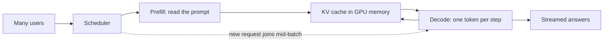

> [!crumbs] [[00 Start Here|🏠 Home]] › [[Part 2 AI System Design|Part 2]] › [[Modern LLM Systems]] › LLM Inference & Optimization

> [!tldr] In one sentence
> LLM inference is the work a trained AI model does every time it answers, and optimizing it means **serving more answers, faster, on the same expensive hardware**.

## 🧠 Think of it like…

> [!analogy] One barista, one very expensive espresso machine
> The machine is fast, but every drink needs a walk to the fridge for milk. A smart barista grabs milk for many cups per trip and jots down each order so they never ask twice. The moment one cup is handed over, a new order takes its place.

The espresso machine is a **GPU**, the chip that runs AI models. The walk to the fridge is reading the model from memory, often the slowest step. Grouping cups is **batching**, and the notes are the **KV cache**.

## What it is

**Inference** means running a trained model to get an answer. A **large language model (LLM)** writes its answer one **token** at a time, where a token is a chunk of text about the size of a short word.

Each answer has two phases:[^1]

- **Prefill.** The model reads your whole question at once. This keeps the GPU busy.
- **Decode.** The model writes the answer token by token. Each token re-reads the whole model from memory, so this phase waits on memory, not math.

Users feel two numbers: **time to first token**, until words appear, and **time per output token**, how fast they keep coming.[^2]

## Why it matters

- **GPUs are costly.** Doubling what each serves can halve the bill.
- **Speed shapes the experience.** A reply slow to start feels broken.
- **Memory is the real limit.** A small model can need about 2 GB of extra memory for one long conversation.[^1] That caps how many users a GPU serves.

## How it works

Serving systems stack tricks:

- **KV cache.** The model saves its working notes for every token so it never redoes that work.[^1]
- **Continuous batching.** A finished answer leaves the group at once and a new request takes its seat. One test measured 8 times the old throughput, and **23 times** with the smarter memory below.[^3]
- **Smarter memory.** The **vLLM** project stores the KV cache in small pages. Earlier systems wasted 60–80% of that memory; vLLM wastes under 4%.[^4]
- **Quantization.** Storing the model's numbers with fewer bits makes it smaller and faster, at some risk to quality.[^1]
- **Speculative decoding.** A small model guesses the next few tokens; the big model checks them in one step. It ran 2–3 times faster with **exactly the same output**.[^5]

## A real-world example

LMSYS, the team behind Chatbot Arena, a public site for comparing chatbots, switched its serving to vLLM in 2023. That let it handle up to 5 times more traffic and **cut the GPUs it needed by half**.[^4]

## Myths and pitfalls

- **❌ Myth:** A faster chip is all that matters. **✅ Reality:** Answer speed often depends on memory speed more than raw computing power.[^2]
- **❌ Myth:** Bigger batches are always better. **✅ Reality:** They raise total output but make each user wait longer. One test saw 14 times the throughput with 4 times the delay.[^2]
- **❌ Myth:** Every speed trick costs accuracy. **✅ Reality:** Speculative decoding keeps the answer identical.[^5] Quantization is the trick that can trade quality for speed.[^1]

## Check yourself

> [!question]- Why does writing an answer wait on memory rather than math?
> Each new token needs the whole model read from memory again, but little math. Moving the data takes longer than computing.

> [!question]- What does continuous batching change?
> A finished answer leaves right away and a waiting request takes its place, so the GPU never idles.

> [!question]- Your chatbot's replies take too long to start. Which number are you looking at?
> Time to first token, driven mostly by reading the prompt.

## Key terms

- **Inference** — running a trained model to get an answer.
- **Token** — a small chunk of text the model reads and writes one at a time.
- **KV cache** — the model's saved working notes for every token so far.
- **Continuous batching** — letting requests join and leave the batch at every step.
- **Quantization** — storing the model with fewer bits per number to save memory.
- **Speculative decoding** — a small model drafts tokens and the big model checks them.

## 🧱 Builds on

- [[Caching]] — the KV cache keeps computed results so the model never redoes them.
- [[Concurrency]] — batching serves many users at once on one GPU.
- [[Load Balancing]] — spreads requests across GPU servers.
- [[Estimation]] — memory and speed math tells you how many GPUs you need.

> [!deepdive] Ready for the technical take?
> Prefill vs. decode, KV cache math, PagedAttention, quantization and speculative decoding trade-offs, and numbers to quote.
> → [[LLM Inference & Optimization (Deep Dive)]]

## Related

- [[Deployment & Serving]] — how models get onto servers in the first place.
- [[Cost Optimization]] — inference is often the biggest line on the AI bill.
- [[AI Agents & Tool Use]] — agents make many model calls per task, so speed adds up.

> [!nav] Keep going
> ← [[Retrieval-Augmented Generation]] · [[Modern LLM Systems|🤖 Modern LLM Systems]] · [[AI Agents & Tool Use]] →
> 🔬 Technical take: [[LLM Inference & Optimization (Deep Dive)]] · 🗺️ [[Glossary]]

## 📚 Sources

[^1]: 📝 [Mastering LLM Techniques: Inference Optimization](https://developer.nvidia.com/blog/mastering-llm-techniques-inference-optimization/) — NVIDIA Technical Blog, 2023. Engineering blog. Checked 2026-11.
[^2]: 📝 [LLM Inference Performance Engineering: Best Practices](https://www.databricks.com/blog/llm-inference-performance-engineering-best-practices) — Databricks (MosaicML), 2023. Engineering blog. Checked 2026-11.
[^3]: 📝 [How continuous batching enables 23x throughput in LLM inference while reducing p50 latency](https://www.anyscale.com/blog/continuous-batching-llm-inference) — Anyscale, 2023. Engineering blog. Checked 2026-11.
[^4]: 📝 [vLLM: Easy, Fast, and Cheap LLM Serving with PagedAttention](https://vllm.ai/blog/2023-06-20-vllm) — vLLM team, UC Berkeley, 2023. Engineering blog. Checked 2026-11.
[^5]: 🔬 [Fast Inference from Transformers via Speculative Decoding](https://arxiv.org/abs/2211.17192) — Leviathan, Kalman and Matias, ICML 2023. Paper. Checked 2026-11.
