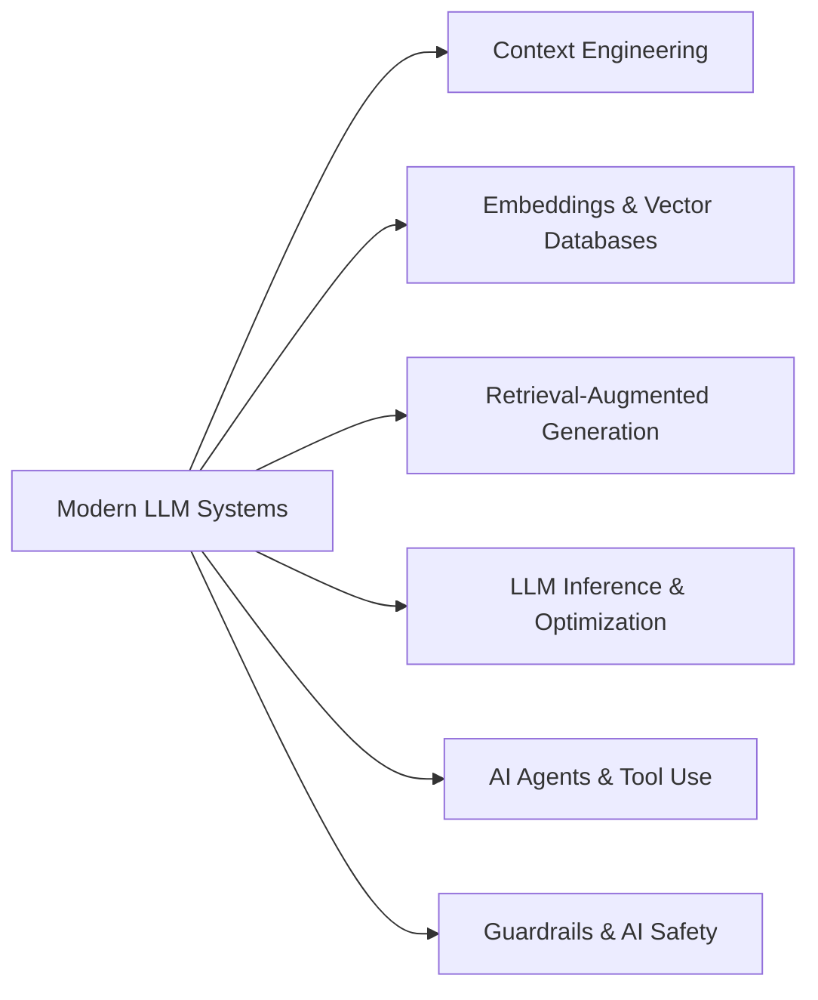

> [!crumbs] [[00 Start Here|🏠 Home]] › [[Part 2 AI System Design|Part 2]] › Modern LLM Systems

> [!hub] 🤖 Modern LLM Systems
> The patterns behind today's chatbots, copilots and agents built on large language models.

## Topics

| Topic | In one line | Technical take |
| --- | --- | --- |
| [[Context Engineering]] | Deciding exactly what goes into a model's input so it answers well. | [[Context Engineering (Deep Dive)\|🔬 Deep dive]] |
| [[Embeddings & Vector Databases]] | Turning meaning into numbers so you can search by similarity. | [[Embeddings & Vector Databases (Deep Dive)\|🔬 Deep dive]] |
| [[Retrieval-Augmented Generation]] | Letting a model look things up before it answers. | [[Retrieval-Augmented Generation (Deep Dive)\|🔬 Deep dive]] |
| [[LLM Inference & Optimization]] | Making large models answer fast and cheaply. | [[LLM Inference & Optimization (Deep Dive)\|🔬 Deep dive]] |
| [[AI Agents & Tool Use]] | Models that plan, call tools and take steps toward a goal. | [[AI Agents & Tool Use (Deep Dive)\|🔬 Deep dive]] |
| [[Guardrails & AI Safety]] | Checks around a model that keep its inputs and outputs safe. | [[Guardrails & AI Safety (Deep Dive)\|🔬 Deep dive]] |

## The shape of it

> [!tip] How to read these
> Every topic has a **🌱 basics** note (no jargon, about 5 minutes) and a **🔬 deep dive** (the technical take). Start with the basics; open the deep dive when you want more.
