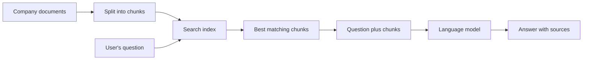

> [!crumbs] [[00 Start Here|🏠 Home]] › [[Part 2 AI System Design|Part 2]] › [[Modern LLM Systems]] › Retrieval-Augmented Generation

> [!tldr] In one sentence
> Retrieval-augmented generation (RAG) lets an AI model **look up the right documents first** and answer from them, instead of relying only on what it memorized in training.

## 🧠 Think of it like…

> [!analogy] An open-book exam
> A student who studied hard still forgets details and knows nothing after the course ended. Let them bring the textbook, and they can check the exact page and tell you where they found it.

The AI model is the student; its training is the studying. RAG hands it only the few pages that matter for this question, so the answer is more accurate, current and checkable.

## What it is

A **large language model (LLM)**, the AI behind chatbots, only knows its training data. That can be out of date, and the model can **hallucinate**: state something false with confidence.[^1]

RAG fixes this in three steps:

1. **Retrieve:** search your documents for related passages.
2. **Augment:** paste them into the model's input beside the question.
3. **Generate:** the model answers from those passages.[^1]

The name comes from a 2020 paper that paired a language model with a searchable index of Wikipedia, giving more specific and factual answers than the model alone.[^2] Basing answers on retrieved sources is called **grounding**.

## Why it matters

- **Fresh and private knowledge.** The model can use today's prices or internal policies without retraining.[^1]
- **Fewer made-up answers.** It works from real text, not memory.[^2]
- **You can check the work.** Answers can cite the pages they used.[^2]
- **Sometimes you don't need it.** If your material fits in about 500 pages, just give the model all of it.[^3]

## How it works

**Before any question arrives,** documents are split into **chunks**, passages of a few hundred words or less, and stored in a search index.[^3] Tiny chunks lose meaning; huge ones blur ideas.[^4]

**When a question arrives,** good systems use two kinds of search together, called **hybrid search**:[^3]

- **Search by meaning** finds the same idea in different words (see [[Embeddings & Vector Databases]]).
- **Keyword search** catches exact terms, like an error code or a product name.[^3]

Both lists merge into one ranking.[^5] A slower, more careful model often **reranks** the top candidates, reading each next to the question.[^6] Only the best few reach the model.

## A real-world example

DoorDash built a voice assistant for support calls from its delivery drivers, grounded in its public help center through Amazon Bedrock's knowledge base service.[^7] It responds within 2.5 seconds, handles hundreds of thousands of calls a day, and cut handoffs to humans by thousands daily.[^7]

## Myths and pitfalls

- **❌ Myth:** RAG stops a model from ever being wrong. **✅ Reality:** If search misses the right passage, the model answers anyway. In one test, standard search left 5.7% of relevant passages out of its top 20.[^3]
- **❌ Myth:** Meaning-based search is all you need. **✅ Reality:** It can miss exact codes and names. Adding keyword search reduced misses in the same test.[^3]
- **❌ Myth:** Send as many chunks as will fit. **✅ Reality:** Extra text can distract the model, so teams test how many to send.[^3]
- **❌ Myth:** Every AI app needs RAG. **✅ Reality:** For a small set, putting everything in the prompt is simpler.[^3]

## Check yourself

> [!question]- What do the three words in "retrieval-augmented generation" stand for?
> Find relevant passages, add them to the model's input, then write the answer from them.

> [!question]- A question about error "E-4021" gets an answer about a different error. Why?
> Meaning-based search found general error passages but missed the exact code. Keyword search catches it.

> [!question]- Why is RAG often cheaper than retraining the model on your documents?
> You only update the index when documents change; the model reads the latest passages at question time.

## Key terms

- **RAG** — giving the model relevant documents before it answers.
- **Grounding** — basing an answer on specific source text rather than memory.
- **Hallucination** — a confident answer that is false or made up.
- **Chunk** — a short passage cut from a longer document for searching.
- **Hybrid search** — combining meaning-based search with keyword search.
- **Reranking** — a careful second pass that reorders the top results.
- **Knowledge base** — the collection of documents the system can search.

## 🧱 Builds on

- [[Databases]] — the search index is a database that must stay in sync with the original documents.
- [[Caching]] — caching the repeated part of the prompt makes "send everything" far cheaper.[^3]
- [[API Design]] — retriever, reranker and model are services linked by APIs; answers return with citations.

> [!deepdive] Ready for the technical take?
> Chunking strategies, BM25 and rank fusion, cross-encoder reranking, contextual retrieval, evaluation, and the failure modes of production RAG.
> → [[Retrieval-Augmented Generation (Deep Dive)]]

## Related

- [[Embeddings & Vector Databases]] — the meaning-based search inside RAG.
- [[Context Engineering]] — how retrieved chunks fit into the model's input.
- [[Evaluation & Metrics]] — measuring retrieval and answer quality.
- [[Capstone - AI Support Assistant]] — a full support bot built on RAG.

> [!nav] Keep going
> ← [[Embeddings & Vector Databases]] · [[Modern LLM Systems|🤖 Modern LLM Systems]] · [[LLM Inference & Optimization]] →
> 🔬 Technical take: [[Retrieval-Augmented Generation (Deep Dive)]] · 🗺️ [[Glossary]]

## 📚 Sources

[^1]: 🔬 [Retrieval-Augmented Generation for Large Language Models: A Survey](https://arxiv.org/abs/2312.10997) — Gao et al., 2023–2024. Paper. Checked 2026-11.
[^2]: 🔬 [Retrieval-Augmented Generation for Knowledge-Intensive NLP Tasks](https://arxiv.org/abs/2005.11401) — Lewis et al., NeurIPS 2020. Paper. Checked 2026-11.
[^3]: 📝 [Introducing Contextual Retrieval](https://www.anthropic.com/news/contextual-retrieval) — Anthropic, 2024. Engineering blog. Checked 2026-11.
[^4]: 📝 [Chunking Strategies for LLM Applications](https://www.pinecone.io/learn/chunking-strategies/) — Schwaber-Cohen and Patel, Pinecone, 2025. Article. Checked 2026-11.
[^5]: 📄 [Hybrid search scoring (RRF)](https://learn.microsoft.com/en-us/azure/search/hybrid-search-ranking) — Microsoft Learn, Azure AI Search. Official docs. Checked 2026-11.
[^6]: 📄 [Retrieve & Re-Rank](https://www.sbert.net/examples/applications/retrieve_rerank/README.html) — Sentence Transformers documentation. Official docs. Checked 2026-11.
[^7]: 📝 [Building a Generative AI Contact Center Solution for DoorDash Using Amazon Bedrock, Amazon Connect and Anthropic's Claude](https://aws.amazon.com/solutions/case-studies/doordash-bedrock-case-study/) — Amazon Web Services case study. Article. Checked 2026-11.
