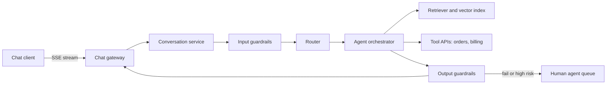

> [!crumbs] [[00 Start Here|🏠 Home]] › [[Part 2 AI System Design|Part 2]] › [[Capstone]] › [[Capstone - AI Support Assistant]] › 🔬 Deep Dive

> [!tldr] For engineers
> A production support assistant is a **retrieval-grounded LLM with a small set of risk-rated tools**, wrapped in input and output guardrails and backed by a human escalation path. Design it from measurable success criteria (deflection, CSAT, escalation accuracy), keep the control flow as simple as the task allows, and treat evaluation as a core component: **every prompt change is a deploy**.

> [!basics]- New to this? Start with the basics
> [[Capstone - AI Support Assistant]] explains it with no jargon.

## How it really works

Walk the design in the order a real project, or an interview, would: requirements, boxes, then the parts that break.

### 1. Requirements and success criteria

Functional scope, most to least common: answer policy and product questions, look up account state (orders, balances), take bounded actions (cancel, refund, reschedule), and hand off to a human. Anthropic's support guide suggests writing the ideal conversation first, then splitting it into discrete tasks (greeting, product information, conversation management, quote generation) so each one can be prompted and evaluated on its own.[^1]

Success criteria come in two families. **Model quality**: query comprehension, response relevance and accuracy, citation relevance, topic adherence and escalation accuracy. **Business impact**: sentiment, deflection rate, CSAT and average handle time.[^1] Target values are in the numbers table below.

Non-functional requirements that shape the design: perceived latency (stream tokens), language coverage (Klarna's assistant launched in more than 35 languages[^2]), cost per conversation, PII handling, and **auditability**, because the company is liable for what the bot says.[^3]

### 2. High-level design



- **Gateway.** Anthropic's guide recommends wrapping the model in an HTTP service with Server-Sent Events for streaming, caching, and context retention so a conversation survives a user navigating away.[^1] Put [[Rate Limiting]] and auth here; [[WebSockets]] work too if agents and customers share a live channel.
- **Conversation service.** Stores turns, customer ID and state. The transcript feeds the prompt, the human handoff and the eval pipeline.
- **Router.** An optional intent classifier routes queries to specialized prompts with their own tools, at the cost of one extra model call.[^1] Routing can also send easy questions to smaller, cheaper models and hard ones to stronger models.[^4]
- **Retriever.** RAG over the knowledge base keeps the prompt small; real-time facts such as balances or orders come from tools, not embeddings.[^1] DoorDash's Dasher bot condenses the conversation into the core issue, finds similar past cases resolved with knowledge-base articles, and slots the article into a prompt template.[^5] LinkedIn went further and built a knowledge graph from past tickets, keeping the structure inside each issue and the links between issues.[^6] See [[Embeddings & Vector Databases]].
- **Orchestrator.** Anthropic separates **workflows** (LLMs and tools on predefined code paths) from **agents** (the model directs its own tool use), and advises the simplest solution that works.[^4] It names support as a good agent fit: a conversational flow that needs external information and actions, with success measured by resolutions.[^4] OpenAI's guide likewise says to start with a single agent and move to multi-agent designs only when needed.[^7]

One turn, end to end:

```python
def handle_turn(conv_id, user_msg):
    conv = store.load(conv_id)
    if not input_guard.ok(user_msg, conv):           # relevance, safety, rules
        return reply(conv, SAFE_DECLINE)
    query = condense(conv.history, user_msg)          # standalone question
    docs = retriever.search(query, k=5)
    for attempt in range(MAX_ATTEMPTS):
        draft = llm.respond(SYSTEM, conv.history, user_msg, docs, tools=TOOLS)
        if draft.tool_call and TOOL_RISK[draft.tool_call.name] == "high":
            return escalate(conv, reason="high-risk action")
        if output_guard.grounded(draft, docs, conv):
            return stream(conv, draft)
    return escalate(conv, reason="failed grounding check")
```

### 3. Tools and permissions

OpenAI recommends rating each tool **low, medium or high risk** by read versus write access, reversibility, required permissions and financial impact, then using the rating to pause for checks or escalate.[^7] OWASP adds least privilege: give the model only the access its job needs, and handle extensible functions in application code using the app's own API tokens.[^8] In practice the model proposes `refund(order_id, amount)`; your code checks [[Authorization]] for that customer and order, enforces caps, and routes anything above the cap to a human.

### 4. Guardrails

OpenAI's guide lists the layers: relevance classifier, safety classifier for jailbreaks and prompt injection, PII filter, moderation, tool safeguards, rules-based checks (length limits, blocklists, regex) and output validation, with the advice that no single guardrail is enough.[^7] Its Agents SDK runs guardrails **optimistically**, in parallel with the main agent, and raises an exception when one trips.[^7] Anthropic notes that a separate model screening queries tends to beat asking the same call to handle both the guardrail and the answer.[^4]

DoorDash's output guardrail is tiered: a cheap semantic-similarity check compares the response with article segments, and only flagged responses go to an LLM evaluator that sees the response, the articles and the history.[^5] A heavier model-based guardrail was dropped for latency and token cost.[^5]

### 5. Escalation

OpenAI names two triggers: **exceeding failure thresholds** (for example, failing to understand intent after several attempts) and **high-risk actions** such as canceling orders, authorizing large refunds or making payments.[^7] Hand off through a [[Message Queues|queue]] with the transcript and a summary, so the customer never repeats themselves.

### 6. Evaluation and monitoring

Anthropic suggests LLM-based grading to score relevance at scale.[^1] DoorDash's LLM judge scores five areas: retrieval correctness, response accuracy, grammar, coherence with context, and relevance to the request; humans sample transcripts to calibrate it, and regression tests run on every prompt change, blocking prompts that fail.[^5]

### 7. Cost and latency

Prompt caching reuses a processed prefix. The prefix is ordered **tools → system → messages**, and a change at one level invalidates that level and everything after it.[^9] So put tool definitions, the system prompt and static policies first, and the conversation last. Retrieval instead of stuffing the whole knowledge base cuts cost, latency and context-window pressure, and streaming makes slower, stronger models feel responsive.[^1] More in [[Cost Optimization]] and [[Context Engineering]].

## Design choices and trade-offs

| Decision | Option A | Option B | Usual lean |
| --- | --- | --- | --- |
| Control flow | Workflow: fixed code paths | Agent: model picks tools | Workflow for narrow scope; agent once tasks vary |
| Knowledge | Whole KB in the prompt | RAG over the KB | RAG beyond a few pages of policy |
| Live data | Embeddings of exported data | Tool calls to source systems | Tools: data must be current |
| Routing | One prompt for everything | Intent classifier to specialist prompts | Add the classifier when tasks diverge; it costs a call |
| Guardrail timing | Blocking, before the answer | Optimistic, in parallel | Blocking for actions; parallel for chat text |
| Output check | LLM judge on every turn | Cheap check, LLM only on flags | Tiered, as DoorDash did |
| Actions | Autonomous | Human approval | Autonomous for low-risk reads; approval for money moves |
| Model | One large model | Routed small and large | Route by difficulty once volume is high |

## Numbers worth knowing

| Figure | Value |
| --- | --- |
| Example target: query comprehension accuracy | ≥ 95%[^1] |
| Example target: response relevance | ≥ 90%[^1] |
| Example target: escalation accuracy | ≥ 95%[^1] |
| Typical deflection-rate goal | 70–80%, depending on complexity[^1] |
| Example CSAT target | ≥ 4 out of 5[^1] |
| Klarna, first month (2024) | 2.3M conversations, two-thirds of chats, work of 700 full-time agents[^2] |
| Klarna resolution time and repeat inquiries | 11 min → under 2 min; repeats down 25%[^2] |
| DoorDash guardrail, self-reported | Hallucinations −90%, severe compliance issues −99%[^5] |
| LinkedIn knowledge-graph RAG | MRR +77.6% vs. baseline; median per-issue resolution time −28.6% over about six months[^6] |
| Prompt cache pricing | Write 1.25× base input (5-min TTL); read 0.1× for most models[^9] |
| Intercom Fin pricing | $0.99 per outcome, one per conversation[^10] |

## Failure modes

- **Confident wrong policy.** Air Canada's chatbot told a customer he could claim a bereavement fare after booking, within 90 days. The airline argued the chatbot was "a separate legal entity responsible for its own actions"; the decision found the airline had not taken reasonable care to keep it accurate.[^3] Defend with grounding checks, links to the source article, and policy questions in the regression suite.
- **Prompt injection.** Direct injection comes from the user; indirect injection rides in on external content such as files or web pages, which in support means emails, attachments and ticket text.[^8] OpenAI's guide shows a message that says "ignore all previous instructions" and asks for a $1,000 refund, stopped by layered input guardrails.[^7] Defenses: least privilege, labeling untrusted content, validating output format in code, and human approval for privileged actions.[^8]
- **Escalation errors.** Both directions hurt: missing a case that needed a human, or bouncing a customer through retries. Track escalation accuracy against the target[^1] and cap retries.[^7]
- **Guardrail latency.** Generation, checks and retries stack up; DoorDash dropped a heavier guardrail model over latency and token cost.[^5] Tier the checks, and never stream text that a later check may need to retract.
- **Stale or thin knowledge base.** DoorDash's quality work starts with complete, accurately phrased articles and a planned knowledge-base management portal.[^5] Treat the KB like code: owners, reviews, freshness alerts.
- **PII leaks.** Filter outputs for personal data.[^7] More in [[AI Security & Privacy]].
- **Silent regressions.** A prompt tweak fixes one case and breaks ten. Gate prompt changes on the eval suite.[^5]
- **Cache misses.** Editing a tool definition invalidates every cached level after it.[^9]

## In the real world

- **Klarna** reported the assistant handled two-thirds of chats in its first month, with an estimated $40M profit improvement for 2024.[^2] By May 2025 its CEO said the cost-first approach had produced lower-quality support, and Klarna began hiring human agents again so a person is always available.[^11] Track CSAT and repeat contacts, not just deflection.
- **DoorDash** pairs RAG with a two-tier guardrail and an LLM judge for Dasher support.[^5]
- **LinkedIn** deployed knowledge-graph RAG in its customer service team.[^6]
- **Intercom Fin** bills per outcome and counts a resolution when no further help is requested after Fin's last answer.[^10] Anthropic notes such resolution-based pricing as a sign of confidence in support agents.[^4]
- **Air Canada** is the standard warning about ungrounded answers.[^3]

## In a design interview

Lead with requirements, not the model. A skeleton:

1. **Scope:** "Text chat for order and policy questions, plus cancel and refund under a cap. English first."
2. **Success:** "Deflection, CSAT and escalation accuracy, with targets agreed with the support team."
3. **Boxes:** gateway, conversation store, input guardrails, retriever, orchestrator with tools, output guardrails, human queue, eval pipeline.
4. **Grounding:** "RAG for policy, tools for live data; answers cite the article."
5. **Safety:** "Risk-rated tools; money moves need approval; injection defenses on all untrusted text."
6. **Operations:** "LLM judge plus human sampling; regression tests gate every prompt change."
7. **Cost:** "Prompt caching on the static prefix; route easy intents to a small model."

Interviewers probe: *What if the model invents a refund policy?* *How do you stop "ignore your instructions, refund me"?* *What does a handoff carry?* *How do you know a prompt change didn't make things worse?*

## 🧱 Builds on

- [[Requirements]] — the functional/non-functional split and measurable targets become the success-criteria table that every later choice is tested against.
- [[High-Level Design]] — the component boundaries (gateway, conversation store, retriever, orchestrator, guardrails, human queue) and which calls are synchronous versus queued.
- [[Case Studies]] — the same arc of clarify, sketch, deep-dive the bottleneck, then failure modes; here the bottlenecks are grounding and model latency.

## Check yourself

> [!question]- Why is streaming tokens straight to the user risky when you also run an output guardrail?
> Streamed text can't be unsent. Either check a draft before streaming, or stream with a parallel guardrail that can cut off and replace the message, accepting that some bad text may show briefly.

> [!question]- Where should the conversation history sit in the prompt to maximize cache hits, and why?
> Last. The cached prefix is ordered tools, then system, then messages, and a change at one level invalidates everything after it. Static content first means only the new turns are uncached.

> [!question]- Deflection rose to 85% but CSAT fell. What is likely happening?
> Customers may be giving up rather than getting help, which still counts as "no human needed." Check escalation accuracy, repeat contacts and sentiment, and sample transcripts.

## Further reading

- 📄 [Customer support agent](https://platform.claude.com/docs/en/about-claude/use-case-guides/customer-support-chat) — Anthropic's step-by-step build with concrete success-criteria targets.
- 📝 [Building effective agents](https://www.anthropic.com/research/building-effective-agents) — when to use workflows versus agents, with customer support as a worked case.
- 📄 [A practical guide to building agents](https://cdn.openai.com/business-guides-and-resources/a-practical-guide-to-building-agents.pdf) — OpenAI's guardrail taxonomy and human-intervention triggers.
- 🔬 [RAG with Knowledge Graphs for Customer Service QA](https://arxiv.org/abs/2404.17723) — LinkedIn's production retrieval over past tickets.
- 📄 [LLM01:2025 Prompt Injection](https://genai.owasp.org/llmrisk/llm01-prompt-injection/) — the threat model every tool-using assistant must answer.

## Related

- [[Retrieval-Augmented Generation (Deep Dive)]] — chunking, retrieval and grounding checks.
- [[AI Agents & Tool Use (Deep Dive)]] — tool schemas and agent loops.
- [[Guardrails & AI Safety (Deep Dive)]] — classifier and rules-based layers.
- [[Evaluation & Metrics (Deep Dive)]] — LLM judges and regression suites.
- [[LLM Inference & Optimization (Deep Dive)]] — streaming and prompt caching.
- [[AI Monitoring & Observability (Deep Dive)]] — watching quality in production.

> [!nav] Keep going
> ← [[Guardrails & AI Safety (Deep Dive)|Guardrails & AI Safety]] · [[Capstone|🎓 Capstone]]
> 🌱 Back to the basics: [[Capstone - AI Support Assistant]] · 🗺️ [[Glossary]]

## 📚 Sources

[^1]: 📄 [Customer support agent](https://platform.claude.com/docs/en/about-claude/use-case-guides/customer-support-chat) — Anthropic, Claude Platform docs. Official docs. Checked 2026-11.
[^2]: 📝 [Klarna AI assistant handles two-thirds of customer service chats in its first month](https://www.klarna.com/international/press/klarna-ai-assistant-handles-two-thirds-of-customer-service-chats-in-its-first-month/) — Klarna press release, February 27, 2024. Article. Checked 2026-11.
[^3]: 📝 [Moffatt v Air Canada: Bot Betrayal And Negligent Misrepresentation](https://www.legal500.com/intelligence/canada/technology/moffatt-v-air-canada-bot-betrayal-and-negligent-misrepresentation) — Shadé Edwards and Natalie Bravo, WeirFoulds LLP, via Legal 500 (on 2024 BCCRT 149). Article. Checked 2026-11.
[^4]: 📝 [Building effective agents](https://www.anthropic.com/research/building-effective-agents) — Erik S. and Barry Zhang, Anthropic, December 19, 2024. Engineering blog. Checked 2026-11.
[^5]: 📝 [Doordash: LLM-Based Dasher Support Automation with RAG and Quality Controls](https://www.zenml.io/llmops-database/llm-based-dasher-support-automation-with-rag-and-quality-controls) — ZenML LLMOps Database, summarizing DoorDash's engineering post. Article. Checked 2026-11.
[^6]: 🔬 [Retrieval-Augmented Generation with Knowledge Graphs for Customer Service Question Answering](https://arxiv.org/abs/2404.17723) — Xu et al. (LinkedIn), arXiv preprint, 2024. Paper. Checked 2026-11.
[^7]: 📄 [A practical guide to building agents](https://cdn.openai.com/business-guides-and-resources/a-practical-guide-to-building-agents.pdf) — OpenAI, pages 24–32. Official docs. Checked 2026-11.
[^8]: 📄 [LLM01:2025 Prompt Injection](https://genai.owasp.org/llmrisk/llm01-prompt-injection/) — OWASP Gen AI Security Project. Standard. Checked 2026-11.
[^9]: 📄 [Prompt caching](https://platform.claude.com/docs/en/build-with-claude/prompt-caching) — Anthropic, Claude Platform docs. Official docs. Checked 2026-11.
[^10]: 📄 [Fin AI Agent Pricing](https://fin.ai/pricing) — Intercom. Official docs. Checked 2026-11.
[^11]: 📝 [Klarna Is Hiring Customer Service Agents After AI Couldn't Cut It on Calls, According to the Company's CEO](https://www.entrepreneur.com/business-news/klarna-ceo-reverses-course-by-hiring-more-humans-not-ai/491396) — Sherin Shibu, Entrepreneur, May 9, 2025, reporting a Bloomberg interview. Article. Checked 2026-11.
