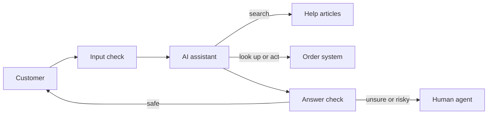

> [!crumbs] [[00 Start Here|🏠 Home]] › [[Part 2 AI System Design|Part 2]] › [[Capstone]] › Capstone - AI Support Assistant

> [!tldr] In one sentence
> An AI support assistant is a chat helper that **answers customers from the company's own help articles and account data**, takes simple actions, and **hands hard cases to a person**.

## 🧠 Think of it like…

> [!analogy] A new hire at the help desk
> A new hire gets a binder of policies, a login to the order system, and one rule: "If you're not sure, ask your manager." They look things up instead of guessing.

The binder is the **knowledge base** (the company's library of help articles). The login is a set of **tools**, connections that let the assistant look up or change real records. The manager is a human support agent.

The brain is a **large language model (LLM)**, a program trained on huge amounts of text to read and write language.

## What it is

This capstone pulls Part 2 into one design: a chat assistant for an online shop, built step by step.

A support chat is several jobs in one conversation: greeting, answering product questions, staying on topic, and tasks such as preparing a quote.[^1] Each job needs its own instructions and tests.[^1]

## Why it matters

- **Volume.** Most questions repeat, and an assistant answers them at any hour.[^1]
- **Speed.** Klarna said its assistant cut resolution time from 11 minutes to under 2.[^2]
- **Responsibility.** The company owns whatever the bot says. A Canadian tribunal held Air Canada liable after its chatbot gave a grieving customer wrong fare information.[^3]

## How it works

A team builds it in seven steps:

1. **Agree on goals.** Decide what "good" means, such as the share of chats solved without a person.[^1] This is [[Requirements]] work.
2. **Sketch the big boxes.** Draw the [[High-Level Design]]: chat window, assistant, search, tools, checks, human queue.
3. **Ground the answers.** The assistant searches the help articles before replying. This is **[[Retrieval-Augmented Generation|retrieval-augmented generation (RAG)]]**: look it up, then write.[^1]
4. **Give it tools, carefully.** Checking an order is low risk. A large refund is high risk, so it waits for a human.[^4]
5. **Add guardrails.** **Guardrails** are automatic checks: one blocks off-topic or malicious messages, another checks each answer against the articles.[^4][^5]
6. **Plan the handoff.** **Escalation** means passing the chat to a person, for example after repeated misunderstandings.[^4]
7. **Measure and improve.** Score real chats, fix repeated mistakes, and retest before every change.[^5]

## A real-world example

Klarna launched an OpenAI-powered assistant in early 2024. In its first month it held **2.3 million conversations**, two-thirds of its customer service chats.[^2] Klarna said that equaled 700 full-time agents, with satisfaction on par with humans.[^2] In May 2025, though, Klarna's CEO said the cost-first push had **lowered quality**, and the company began hiring human agents again.[^6]

## Myths and pitfalls

- **❌ Myth:** The AI already knows the answers. **✅ Reality:** It doesn't know your refund rules. Good assistants look them up first.[^1]
- **❌ Myth:** A wrong answer is the bot's problem. **✅ Reality:** Air Canada argued its chatbot was a separate legal entity, and lost.[^3]
- **❌ Myth:** More freedom makes a better assistant. **✅ Reality:** Canceling orders or large refunds should get human review until the assistant earns trust.[^4]
- **❌ Myth:** The goal is to replace every agent. **✅ Reality:** Hard cases still need people. Even Klarna now promises a human whenever customers want one.[^6]

## Check yourself

> [!question]- Why does the assistant search help articles before it answers?
> So the reply rests on the company's real policies, not on guesses. That is what RAG means.

> [!question]- A customer asks for a $2,000 refund. What should the assistant do?
> Treat it as high risk: collect the details, then hand it to a human for approval.

> [!question]- Why agree on success measures before building?
> Without them, nobody can tell whether the assistant actually helps.

## Key terms

- **LLM (large language model)** — a program trained on huge amounts of text that reads and writes language.
- **Knowledge base** — the company's library of help articles and policies.
- **RAG** — look up relevant documents first, then write the answer from them.
- **Guardrail** — an automatic check that blocks unsafe messages or wrong answers.
- **Escalation** — passing the conversation to a human agent.
- **Deflection rate** — the share of questions solved without a human.

## 🧱 Builds on

- [[Requirements]] — step 1 turns "help customers faster" into measurable targets.
- [[High-Level Design]] — step 2 draws the boxes and arrows.
- [[Case Studies]] — the capstone follows a classic design case study from start to finish.

> [!deepdive] Ready for the technical take?
> Success-criteria targets, the component diagram, tiered guardrails, tool risk ratings and an interview answer skeleton.
> → [[Capstone - AI Support Assistant (Deep Dive)]]

## Related

- [[AI Agents & Tool Use]] — how it checks orders and takes actions.
- [[Guardrails & AI Safety]] — the checks around every message.
- [[Evaluation & Metrics]] — scoring the assistant before and after launch.
- [[Business Goals & Requirements]] — where the success measures come from.
- [[AI Monitoring & Observability]] — watching quality once customers arrive.

> [!nav] Keep going
> ← [[Guardrails & AI Safety]] · [[Capstone|🎓 Capstone]]
> 🔬 Technical take: [[Capstone - AI Support Assistant (Deep Dive)]] · 🗺️ [[Glossary]]

## 📚 Sources

[^1]: 📄 [Customer support agent](https://platform.claude.com/docs/en/about-claude/use-case-guides/customer-support-chat) — Anthropic, Claude Platform docs. Official docs. Checked 2026-11.
[^2]: 📝 [Klarna AI assistant handles two-thirds of customer service chats in its first month](https://www.klarna.com/international/press/klarna-ai-assistant-handles-two-thirds-of-customer-service-chats-in-its-first-month/) — Klarna press release, February 27, 2024. Article. Checked 2026-11.
[^3]: 📝 [Moffatt v Air Canada: Bot Betrayal And Negligent Misrepresentation](https://www.legal500.com/intelligence/canada/technology/moffatt-v-air-canada-bot-betrayal-and-negligent-misrepresentation) — Shadé Edwards and Natalie Bravo, WeirFoulds LLP, via Legal 500. Article. Checked 2026-11.
[^4]: 📄 [A practical guide to building agents](https://cdn.openai.com/business-guides-and-resources/a-practical-guide-to-building-agents.pdf) — OpenAI, pages 24–32. Official docs. Checked 2026-11.
[^5]: 📝 [Doordash: LLM-Based Dasher Support Automation with RAG and Quality Controls](https://www.zenml.io/llmops-database/llm-based-dasher-support-automation-with-rag-and-quality-controls) — ZenML LLMOps Database, summarizing DoorDash's engineering post. Article. Checked 2026-11.
[^6]: 📝 [Klarna Is Hiring Customer Service Agents After AI Couldn't Cut It on Calls, According to the Company's CEO](https://www.entrepreneur.com/business-news/klarna-ceo-reverses-course-by-hiring-more-humans-not-ai/491396) — Sherin Shibu, Entrepreneur, May 9, 2025, reporting a Bloomberg interview. Article. Checked 2026-11.
