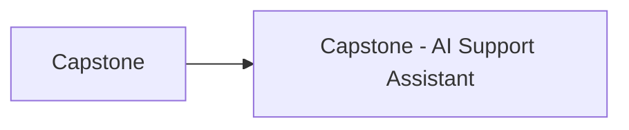

> [!crumbs] [[00 Start Here|🏠 Home]] › [[Part 2 AI System Design|Part 2]] › Capstone

> [!hub] 🎓 Capstone
> One AI system designed from start to finish, using every part of the vault.

## Topics

| Topic | In one line | Technical take |
| --- | --- | --- |
| [[Capstone - AI Support Assistant]] | Designing an AI customer-support assistant end to end, step by step. | [[Capstone - AI Support Assistant (Deep Dive)\|🔬 Deep dive]] |

## The shape of it

> [!tip] How to read these
> Every topic has a **🌱 basics** note (no jargon, about 5 minutes) and a **🔬 deep dive** (the technical take). Start with the basics; open the deep dive when you want more.
